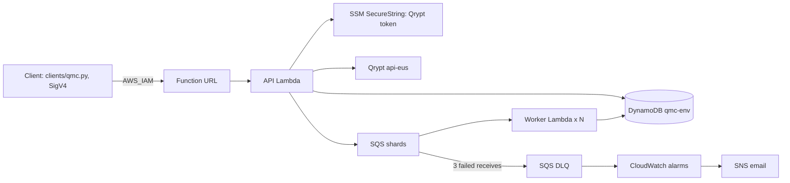

# Quantum-Seeded Monte Carlo

<!-- One-line description (≤ 120 characters; final wording at G4): -->
**Serverless Monte Carlo option pricing on AWS, seeded by Qrypt quantum entropy, replayable bit for bit, at $0/month.**

> **CI:** green on `main` `ea3820c` ([pipeline 52736](https://labs.gauntletai.com/jamesmcgirr/quantum-seeded-monte-carlo/-/pipelines/52736)): lint, unit (320 passed, 96% coverage), golden hash (7 passed, emulated amd64), Terraform validate, tflint, Checkov (blocking since MR !37), and a guard against `data "aws_ssm_parameter"`. Also green on GitHub Actions, where the golden job runs natively on x86 ([run 38392842904](https://github.com/jrmcgirr/quantum-seeded-monte-carlo/actions/runs/38392842904), `d0af0b1`). Latest: [run 38429804576](https://github.com/jrmcgirr/quantum-seeded-monte-carlo/actions/runs/38429804576) on `61d8b42`, all 7 jobs green, including the antithetic golden constants and Checkov as a blocking job.

## What it does and for whom

It prices a European call under Black-Scholes by Monte Carlo. Each job is seeded from one 1 KiB block of Qrypt quantum entropy, split into shards that run in parallel on Lambda, and aggregated into an estimate, standard error and 95% confidence interval, shown next to the closed-form Black-Scholes price. Any completed job can be replayed from its stored seed, and the replay reports whether the result is bit-identical.

- **Analysts** get independent, non-reused seeds and a price with its error bars.
- **Operators** get one `terraform apply`, a $1 Budget, alarms and a clean `terraform destroy`.
- **Auditors and model-risk reviewers** get the seed's provenance and a byte-level replay of any reported number.

## Architecture



Every AWS resource, the submit and replay sequences, and the fail-closed branch: [docs/ARCHITECTURE.md](docs/ARCHITECTURE.md).

## Grader quick-start

Rehearsed from a fresh clone of GitHub `main` on 2026-10-15 (QMC-157): `make destroy` at `bc0637c` (34 destroyed, then the step 7 checks all `[]`), then `make build && make apply` from empty at `a5b9ec0`: 37 resources in 110 s, with the watcher and the grader user on, followed by a plan with no changes. Every command ran as written; the rehearsal only added `-auto-approve` because it ran unattended.

### Prerequisites

- An AWS account and CLI v2 credentials with admin rights. The stack defaults to **us-east-2**, the only Region we tested. To use another Region, set `region = "<region>"` in the settings file (step 3) and create the SSM parameter in that same Region (step 2).
- Terraform ≥ 1.10, Python 3.13, [uv](https://docs.astral.sh/uv/), `make`. Docker is optional (only for `make test-golden`).
- If you sign in with `aws login`, Python tools need `botocore[crt]` to read those credentials; `make setup` installs it.
- A Qrypt **Entropy** token from [portal.qrypt.com](https://portal.qrypt.com).

### 0. Clone

```sh
git clone https://github.com/jrmcgirr/quantum-seeded-monte-carlo.git
cd quantum-seeded-monte-carlo
```

### 1. Configure AWS credentials

```sh
aws configure            # or aws login / SSO; Region us-east-2
aws sts get-caller-identity
```

### 2. Store the Qrypt token in SSM (out-of-band)

The token is created by the CLI, never passed to Terraform, so it never lands in Terraform state or the repo; Terraform only knows the parameter's name. `read -s` keeps it out of shell history and `ps`.

```sh
read -rs QRYPT_API_KEY
printf %s "$QRYPT_API_KEY" | aws ssm put-parameter --region us-east-2 \
  --name /qmc/qrypt-api-key --type SecureString --value file:///dev/stdin
unset QRYPT_API_KEY
```

### 3. Settings, build and deploy

Settings live **outside the checkout**, at `~/.qmc/dev.tfvars`, so they can never be committed. Terraform state goes to `~/.qmc/state/dev.tfstate`. Start from the example:

```sh
mkdir -p ~/.qmc && cp infra/terraform.tfvars.example ~/.qmc/dev.tfvars && chmod 600 ~/.qmc/dev.tfvars
```

| Setting | Default | What it does |
| --- | --- | --- |
| `alert_email` | none (**required**) | Receives alarm and Budget emails through the `qmc-dev-alerts` SNS topic |
| `create_grader_user` | `false` | Creates the invoke-only IAM user `qmc-dev-grader`; its access key is made by CLI, never by Terraform |
| `enable_fault_injection` | `false` | Accepts `fault_injection.fail_shards`, for the forced-failure demo |
| `worker_reserved_concurrency` | `null` | Hard cap on concurrent workers; see below |
| `create_budget` | `true` | The account-wide $1 Budget; only one environment per account should create it |
| `enable_step_functions` | `false` | The optional watcher (contract change 007); on in our deployed stack |
| `region` | `us-east-2` | See Prerequisites |

The file holds no secrets: the Qrypt token is only in SSM.

**Worker reserved concurrency.** Check your account's Lambda concurrency limit:

```sh
aws lambda get-account-settings --query AccountLimit.ConcurrentExecutions
```

If it is **110 or more**, set `worker_reserved_concurrency = 10`. AWS keeps 100 unreserved, so a reservation of 10 needs at least 110. If the limit is lower, which is common on new accounts, leave the setting unset (the default is `null`). Fan-out is still capped at 5 concurrent workers by the queue mapping's `maximum_concurrency` (D12, D40).

```sh
make setup
make build && make apply      # make apply runs make build
```

Run it from an up-to-date clone of `main`: `make apply` and `make destroy` refuse a checkout that does not contain `origin/main` (D33). If `main` moved since you cloned, `git pull` first.

Confirm the SNS subscription email straight away: alarm emails are dropped until it is confirmed.

### 4. Submit a job and wait

```sh
uv run python clients/qmc.py submit --S0 100 --K 100 --r 0.05 --sigma 0.2 --T 1 --paths 1000000 --shards 10
uv run python clients/qmc.py wait <job_id>
```

`uv run` uses the project environment from `make setup`, which has botocore for SigV4 signing. The client finds the URL from `terraform output` in this checkout, or from `--url` or `$QMC_API_URL`, and signs with your normal AWS credentials.

| Command | Does |
| --- | --- |
| `submit` | `POST /jobs`. Flags `--S0 --K --r --sigma --T --paths --shards`, plus `--antithetic`, `--queue` (opt-in PENDING_ENTROPY), `--fail-shards 3 …` (needs `enable_fault_injection`), or `--file body.json` |
| `wait <id>` | Polls every 2 s until COMPLETE, PARTIAL or FAILED, printing each status change |
| `get <id>` / `replay <id>` / `list` / `health` | `GET /jobs/{id}` / `POST /jobs/{id}/replay` / `GET /jobs` / `GET /health` |

Output is the JSON response; the exit code is non-zero on any HTTP status ≥ 400.

Submits are spaced at least 2 s apart by our Qrypt limiter. A second submit within 2 s gets 429 `ENTROPY_RATE_LIMITED` with a `Retry-After`, unless it asks to queue (`--queue`).

### 5. Read the result and the Black-Scholes comparison

Annotated output from the rehearsal (2026-10-15 16:11Z, `build_sha` `a5b9ec0`, job `0aaa055f…`). `wait` saw QUEUED at 0.5 s and COMPLETE at 3.0 s; `created_at` to `completed_at` was 3.3 s.

| Field | Value | Meaning |
| --- | --- | --- |
| `master_seed_hex` | `7fcb63e3…7c65` | 256-bit master seed derived from the Qrypt block (HKDF-SHA256) |
| `seed_provenance` | `source: qrypt`, `http_status: 200`, `block_bytes: 1024`, `latency_ms: 359`, `raw_sha256: 5bd442b8…` | Which Qrypt block seeded the job, by hash |
| `result.estimate` | 10.431587435386609 (`0x1.4dcf90740b333p+3`) | Monte Carlo price; the hex form is what replay compares |
| `result.std_error` | 0.014708138756574906 | Standard error over 1,000,000 paths |
| `result.ci95` | [10.402760013144105, 10.460414857629113] | 95% confidence interval; it contains the Black-Scholes price |
| `reference.black_scholes` | 10.450583572185565 | Closed-form price |
| `reference.z_score`, `within_3se` | −1.29, `true` | Distance from Black-Scholes in standard errors |
| `progress`, `failed_shards` | 10/10 done, `[]` | Every shard counted once, none failed |
| `fingerprint` | x86_64, NumPy 2.5.4, `exp_target` X86_V3, `dispatch_enforced: true`, PCG64DXSM, chunk 131072 | The runtime that replay must match |
| `cost_estimate` | 6.091 GB-s, 11 Lambda requests, 21 SQS requests, 26 write units; $0.000128 at list price, **$0.0 after the free tier** | Includes this first job's cold starts; a warm replay was 0.388 GB-s |

### 6. Replay it

```sh
uv run python clients/qmc.py replay <job_id>
uv run python clients/qmc.py wait <replay_job_id>    # replay_check.bit_identical: true
```

At the rehearsal, replay `9dbf6846…` of `0aaa055f…` reused the stored seed (`seed_provenance.source: replay`, no Qrypt call) and was COMPLETE in 3.0 s, with `replay_check`: `bit_identical: true`, `estimate_equal: true`, `shards_compared: 10`, `shard_diffs: []`, `fingerprint_match: true`.

### 7. Tear down

```sh
make destroy
```

If you set `create_grader_user = true` and created an access key for it, delete that key first. The account's managed SCP blocks the clean-up Terraform would otherwise do, so `DeleteUser` fails while a key exists (D44):

```sh
aws iam list-access-keys --user-name qmc-dev-grader
aws iam delete-access-key --user-name qmc-dev-grader --access-key-id <AccessKeyId>
```

Then remove what Terraform never owned, and check that nothing is left:

```sh
aws ssm delete-parameter --region us-east-2 --name /qmc/qrypt-api-key
aws logs describe-log-groups --region us-east-2 --log-group-name-prefix /aws/lambda/qmc-   # expect []
aws sns list-topics --region us-east-2 --query "Topics[?contains(TopicArn, 'qmc-')]"        # expect []
aws dynamodb list-tables --region us-east-2 --query "TableNames[?starts_with(@, 'qmc-')]"   # expect []
```

Terraform creates every log group itself, with 14-day retention, so destroy removes them. WS4's drift check found no orphans after a full destroy (`docs/TEST_RESULTS.md`).

## Calling our deployed endpoint

**Endpoint:** `https://3vyyso35ndaxoup63e5ro6jg2i0dzutl.lambda-url.us-east-2.on.aws/`, kept up through grading and then destroyed. At the rehearsal (2026-10-15 16:11:48Z), `GET /health` returned `status: ok` (DynamoDB ok, SSM ok) with `build_sha` `a5b9ec039e6e259ea13fde3fd320ca9bff3c0394`. The Step Functions watcher is on in this stack.

The URL uses `AWS_IAM` auth. Graders receive an invoke-only access key for the IAM user `qmc-dev-grader` privately; it is never committed and will be deleted after grading.

```sh
export AWS_ACCESS_KEY_ID=… AWS_SECRET_ACCESS_KEY=…     # the grader key
export QMC_API_URL=<endpoint URL>
uv run python clients/qmc.py health
```

Or with `curl` alone:

```sh
curl --aws-sigv4 "aws:amz:us-east-2:lambda" --user "$AWS_ACCESS_KEY_ID:$AWS_SECRET_ACCESS_KEY" \
  -H 'content-type: application/json' "$QMC_API_URL/jobs" \
  -d '{"S0":100,"K":100,"r":0.05,"sigma":0.2,"T":1,"paths":1000000,"shards":10}'
```

## API reference

| Method and path | Purpose | Success |
| --- | --- | --- |
| `POST /jobs` | Validate, seed from Qrypt, record, enqueue | 202 |
| `GET /jobs` | Newest 50 jobs | 200 |
| `GET /jobs/{id}` | Progress, then the result and Black-Scholes reference | 200 |
| `POST /jobs/{id}/replay` | Re-run from the stored seed; reports `replay_check` | 202 |
| `GET /health` | DynamoDB and SSM reachability, deployed build sha | 200 / 503 |

Every route needs a SigV4-signed request (`AWS_IAM`). Every response is JSON and carries `x-request-id` (the Lambda request id). The full contract is HANDOFF §5.

**Request** (`POST /jobs`, a JSON object ≤ 16 KiB). Every failed rule is reported at once in one `VALIDATION_ERROR`, with a `details` list. Limits are the deployed values (`GetFunctionConfiguration` on `qmc-dev-api`, build `8e0eac5`).

| Field | Rule |
| --- | --- |
| `S0`, `K` | number, `0 < x ≤ 1e6` |
| `r` | number, `−1 ≤ r ≤ 1` |
| `sigma` | number, `0 < sigma ≤ 5` |
| `T` | number of years, `0 < T ≤ 50` |
| `paths` | JSON **integer** (`1e6` and `1000000.0` are rejected), `2 ≤ paths ≤ 10,000,000` |
| `shards` | integer, `1 ≤ shards ≤ 50`, `shards ≤ paths`, and at most 1,000,000 paths per shard |
| `variance_reduction` | optional: `"none"` (default) or `"antithetic"` (even `paths ≥ 4`) |
| `on_entropy_failure` | optional: `"reject"` (default) or `"queue"` (PENDING_ENTROPY, below) |
| `fault_injection` | optional: `{"fail_shards": [i, …]}`, each `0 ≤ i < shards`; enabled on our deployed stack (SECURITY.md) |
| anything else | rejected as `unknown field` |

**Job view** (`GET /jobs/{id}`), the main fields:
- `status`: `QUEUED`, then `RUNNING` (derived while shards finish), then `COMPLETE`, `PARTIAL` (with `failed_shards` and a `partial_result` over the shards that did finish) or `FAILED`.
- `progress` `{done, failed, total}`.
- `result` `{estimate, std_error, ci95, n}`, with exact hex forms of each.
- `reference` `{black_scholes, z_score, within_3se}`.
- `master_seed_hex` and `seed_provenance`: the Qrypt call's time, latency, the SHA-256 of the block, and the KDF.
- `fingerprint`: Python, NumPy, CPU architecture, SIMD target, algorithm version, chunk size.
- `replay_check`, on a replay.
- `cost_estimate`.

**Errors.** Each is `{"error": {"code", "message", "details"?}}`. A handler never raises; anything unexpected becomes `INTERNAL_ERROR` with the request id.

| HTTP | Code | When |
| --- | --- | --- |
| 400 | `VALIDATION_ERROR`, `INVALID_JSON`, `BODY_TOO_LARGE`, `UNSUPPORTED`, `FAULT_INJECTION_DISABLED` | A bad request; nothing is written |
| 404 | `JOB_NOT_FOUND`, `ROUTE_NOT_FOUND` | Unknown job id or path |
| 405 | `METHOD_NOT_ALLOWED` | Known path, wrong method |
| 409 | `JOB_NOT_REPLAYABLE` | Replay of a job that is not COMPLETE |
| 429 | `ENTROPY_RATE_LIMITED` | Our 2 s Qrypt gap is taken; `Retry-After` gives the seconds until it ends |
| 503 | `QRYPT_AUTH_FAILED`, `QRYPT_FORBIDDEN` | Qrypt 401, or 403: the token is invalid or expired, or the entropy quota is used up (Qrypt answers both the same way) |
| 503 | `QRYPT_RATE_LIMITED` | Qrypt's own 429, not retried; `Retry-After: 10` |
| 503 | `QRYPT_SERVER_ERROR`, `QRYPT_ENTROPY_UNAVAILABLE`, `QRYPT_TIMEOUT`, `QRYPT_UNREACHABLE` | Qrypt 5xx, 503, the 2.5 s deadline, or a network failure (one quick retry if the gap allows) |
| 502 / 500 | `QRYPT_BAD_RESPONSE` / `QRYPT_BAD_REQUEST` | An unusable or already-used entropy block / Qrypt rejected our request |
| 503 | `SECRET_UNAVAILABLE` | The token could not be read from SSM |
| 503 | `ENQUEUE_FAILED` | SQS refused the shards after retries; the job is marked FAILED |
| 500 | `INTERNAL_ERROR` | Anything unexpected |

Every seeding error (`ENTROPY_RATE_LIMITED`, any `QRYPT_*` code, `SECRET_UNAVAILABLE`) writes **no job** (I1), unless the submit opted into queueing.

**Antithetic variates (opt-in).** Add `"variance_reduction": "antithetic"` to a submit (with an even `paths` ≥ 4). Each pair `(z, −z)` counts as one sample, so `result.n` is the number of pairs. At 1M paths the standard error drops from 0.0147 to 0.0104, a ratio of 0.707, so the variance is about halved at no extra simulation cost. Locally the estimate was z = +0.868 from Black-Scholes, with a seed fixed before the code existed (`tests/correctness/test_antithetic.py`). On the deployed stack, job `166f446d…` gave 500,000 pairs, z = −0.825 and SE 0.707× the plain job's, and its replay `e565b04f…` was bit-identical (D15, [docs/TEST_RESULTS.md](docs/TEST_RESULTS.md)).

**Queue instead of reject (opt-in PENDING_ENTROPY).** By default a submit that cannot get entropy fails closed. Add `"on_entropy_failure": "queue"` (or `--queue` on the client) and a *retryable* failure (our own 429 `ENTROPY_RATE_LIMITED`, a Qrypt 429 or 5xx, a timeout or a network error) returns 202 with `"status": "PENDING_ENTROPY"` instead:

```bash
uv run python clients/qmc.py submit --S0 100 --K 100 --r 0.05 --sigma 0.2 --T 1 --paths 1000000 --shards 10 --queue
```

The job holds no seed yet. The API retries in the background, and the job becomes `QUEUED` only with a Qrypt-derived seed, or ends `FAILED` naming the cause:

- Up to 4 attempts at Qrypt, after waits of 2, 4, 6 and 6 s. `PENDING_BACKOFF_MS` is 2000,4000,8000, with the last value repeating, and each wait is capped so the attempt fits the API's 10 s timeout.
- If our own 2 s limiter is busy (another submit or seeder holds the slot), the seeder waits for the slot plus 0–2 s of random jitter. That wait does not use up an attempt (MR !57).
- The job gives up after 120 s. A GET after that fails a job whose retry was lost.
- A job whose retry was lost does not block new queued submits: once past its 120 s, the next `--queue` submit ends it as FAILED (`PENDING_EXPIRED`) and does not count it toward the 10-job cap (contract change 010, which removed 008's known limit).

An invalid or expired token, a used-up quota (`QRYPT_FORBIDDEN`) or a missing secret still rejects at once and writes nothing. Replaying a pending job returns 409.

**Drill** (WS4, `main` `effb192`, 2026-10-13 19:42Z, contract change 008): 10 concurrent queued submits all ended **COMPLETE**. The 10 Qrypt calls all returned 200, 2.19–3.45 s apart, with at most 5 in any rolling 10 s. The replay of queued job `afaf4d85…` (`8876f9c9…`) was bit-identical. The first run, before the slot-wait fix, completed only 5 of 10, because the seeders retried in step and spent their attempts losing the slot to each other ([docs/TEST_RESULTS.md](docs/TEST_RESULTS.md)).

## How bit-identical replay works, and when it would not hold

**The seed chain** (`src/qmc_core/seeds.py`):
1. The API takes one fresh 1,024-byte block from Qrypt and records its SHA-256, so a block is never used twice.
2. HKDF-SHA256 turns the block into a 256-bit master seed, using a fixed salt and the info string `qmc/master-seed/v1|<job_id>`. The seed is stored as `master_seed_hex`.
3. Shard *i* draws from `PCG64DXSM(SeedSequence(master, spawn_key=(i,)))`. Its random stream depends only on the master seed and *i*, never on which worker runs it, in what order, or how often.
4. A replay creates a new job with the original's seed, parameters and sharding. It makes no Qrypt call.

**Why the numbers come out the same, bit for bit:**
- NumPy is pinned by hash, the functions are x86_64, and `NPY_DISABLE_CPU_FEATURES` stops NumPy from using AVX-512 for `exp`, which differs by 1 ULP.
- Each shard simulates in fixed chunks of 131,072 paths, and adds them up with `math.fsum`, which does not depend on the order of additions.
- Results are stored as hex floats (`float.hex()`), and replay compares those strings, not rounded decimals.

**The fingerprint.** Each shard records Python, NumPy, the CPU architecture, NumPy's `exp` SIMD target, the algorithm version, the generator and the chunk size. Replay compares every shard's sums byte for byte, and the fingerprints separately. CPU model strings differ between Lambda hosts and are deliberately left out of the match. Replay would stop being bit-identical if the algorithm version, NumPy build, architecture or SIMD target changed. The fingerprint names which one did.

**Replay ×20** (QMC-146, build `855e8d6`, `docs/TEST_RESULTS.md`): `make replay-check N=20` replayed the e2e reference job (1M paths, 10 shards) 20 times, in four batches of 5 spaced at least 10 minutes apart. **All 20 were bit-identical**, with `fingerprint_match` true and no shard diffs. The run covered 2 CPU model strings (`Intel(R) Xeon(R) Processor` and `… @ 2.50GHz`) and 17 distinct worker execution environments.

First live evidence (G1, 2026-10-13): WS4's `make e2e` replayed job `edaff921…` bit-identically on Lambda: 10 shards, no diffs, `fingerprint_match: true`, across two reported Xeon CPU models (`docs/TEST_RESULTS.md`). WS2's replay `f1df7275…` of job `5358ec35…` returned `bit_identical: true`, `estimate_equal: true`, 10 shards compared, no shard diffs, `fingerprint_match: true` (`docs/ai-log/WS2.md`).

## Guardrails: Budget, alarms, limits and custom metrics

Deployed values, read on 2026-10-13 with `DescribeAlarms`, `GetFunctionConcurrency`, `ListEventSourceMappings` and `GetFunctionConfiguration` (build `8e0eac5`):

- **Budget:** `qmc-monthly`, $1 a month. It alerts through SNS on actual spend above 1% ($0.01) and above 100%, and on forecast spend above 100% ([docs/COST.md](docs/COST.md)).
- **Seven alarms**, each sending email through `qmc-dev-alerts`, all OK at the time of reading:

  | Alarm | Fires when |
  | --- | --- |
  | `qmc-dev-dlq-depth` | Any message in the DLQ (1-minute maximum > 0) |
  | `qmc-dev-queue-age` | The oldest shard message is over 120 s old |
  | `qmc-dev-worker-errors`, `qmc-dev-api-errors` | Any Lambda error in a minute |
  | `qmc-dev-worker-throttles` | Any worker throttle in a minute |
  | `qmc-dev-jobs-partial` | Any job ends PARTIAL |
  | `qmc-dev-seeding-failures` | Any seeding failure in 5 minutes |

- **Limits:** the request rules above (≤ 10M paths, ≤ 50 shards, ≤ 1M paths per shard).
- **Concurrency:** the queue mapping runs at most 5 workers at once (`maximum_concurrency`, batch size 1). The worker also has reserved concurrency 10 on our account. Each job has a 900 s deadline: a `GET` after it marks any unfinished shards failed, and the job ends PARTIAL (D9).
- **Qrypt:** at most one call per 2 s (below).
- **Custom metrics, and how they relate to Terraform:** there are 8, in namespace `QMC/dev` with no dimensions: `JobsSubmitted`, `JobsCompleted`, `JobsPartial`, `ShardFailures`, `SeedingFailures`, `PathsSimulated`, `EntropyKiB` and `QryptLatencyMs`. Terraform sets the namespace (`METRICS_NAMESPACE`) and creates the alarms and the dashboard on them. The metrics themselves come from Embedded Metric Format (EMF) lines in the functions' logs, so no role needs `cloudwatch:PutMetricData`, whose only valid resource is `*` (D11).

**Dashboard `qmc-dev`** (all 8 custom metrics plus Lambda and SQS metrics). Rendered read-only with `AWS_PROFILE=qmc uv run python docs/images/render_dashboard.py --hours 2` at 2026-10-13 12:56Z, after WS4's replay ×20:

| | |
| --- | --- |
|  |  |
|  |  |
|  |  |
|  |  |

The DLQ depth of 1 (about 11:25–11:45Z) and the shard failure come from the forced-failure drill.

**Forced failure → DLQ alarm → email** (assignment core 6): the alarm `qmc-dev-dlq-depth` went OK → ALARM at 11:48:08 UTC ("Threshold Crossed: 1 datapoint [1.0] was greater than the threshold (0.0)" on `AWS/SQS ApproximateNumberOfMessagesVisible` for `qmc-dev-shards-dlq`). The email arrived through the `qmc-dev-alerts` SNS topic; screenshot below, with the drill evidence in `docs/TEST_RESULTS.md`. The thread also holds two earlier ALARM emails from that morning (WS1's test of the alarm and an earlier forced failure).


 Alarm states at render time are in [docs/images/dashboard-alarms.md](docs/images/dashboard-alarms.md): all 7 were OK.

**Qrypt rate limit.** The assignment requires that concurrent submissions never exceed Qrypt's 30 requests per 10 s. Our limiter enforces a **2 s minimum gap** between Qrypt calls, so at most 5 in any rolling 10 s (D10, contract change 006). Overflow is rejected with 429 `ENTROPY_RATE_LIMITED` and a `Retry-After` giving the seconds until the gap ends. A Qrypt 429 is not retried. Any submit that Qrypt itself refuses fails closed: a 503 naming the cause, no job written.

Qrypt calls are spaced ≥ 2 s apart (≤ 5 per 10 s), and bursts overflow as 429 with `Retry-After`. There was no Qrypt 429 under 006 in the burst or the steady check below. All four bursts of 40 concurrent submits (WS4, `make burst`, `docs/TEST_RESULTS.md`) **never exceeded 30 per 10 s (measured max 15)**:

| Run | Limiter | 202 | Our 429 (with `Retry-After`) | 503 `QRYPT_RATE_LIMITED` (Qrypt's own 429) | Max Qrypt calls in any 10 s |
| --- | --- | --- | --- | --- | --- |
| 12:01:50Z, build `d0af0b1` | 15 per 10 s | 15 | 25 | 0 | 15 |
| 12:55:43Z, build `f3873f8` | 10 per 10 s (004) | 1 | 30 | 9 | 10 |
| 13:13:37Z, build `6dcb3c2` | 1 per 1 s (005) | 1 | 38 | 1 | 2 (one 200, one 429; `qrypt_call` log lines) |
| 13:35:56Z, build `e77a626` | **2 s minimum gap (006, current)** | 1 | 39 (`Retry-After` 1 or 2 s) | 0 | 1 |

Steady check under 006 (13:36:48Z, 2.5 s pacing): 5 Qrypt calls, 2.49–3.03 s apart, all 200, max 4 in any rolling 10 s.

The Qrypt trial key is rated at 1 call/s. Qrypt did not enforce that at 12:01Z, but did from about 12:55Z, as a sliding limit. A call 1.19 s after the previous one was refused even with 1 s windows, and a steady 1.5 s pacing in `make bench` still drew 3 Qrypt 429s. That is why the limiter moved, step by step, to the 2 s gap (D10).

## Why the worker fails closed at init

When the worker starts, it asks NumPy which SIMD target `exp` will use (`qmc_core.fingerprint.assert_reproducible_dispatch`). If that is an AVX-512 target, which gives results 1 ULP different from the pinned AVX2 path, the worker raises before it takes any message (`QMC_ENFORCE_PINNED_DISPATCH=true` on Lambda and in the golden CI job). The messages then wait, retry and reach the DLQ, which alarms. A wrong, non-reproducible number is worse than no number (D2, D36).

This is the only deliberate raise. The handlers otherwise catch everything: the API turns any failure into one of the error responses above, and the worker reports a failed shard to SQS.

## Qrypt token expiry

Our Qrypt token expires **2027-10-12 at about 9:36 PM US Central** (the portal shows local time without a zone; that is CDT, ≈ 2027-10-13 02:36 UTC), about a year after it was created and well past the grading window. The token itself is only in SSM (`/qmc/qrypt-api-key`) and appears nowhere in this repository.

When a token expires, or its monthly entropy quota is used up, Qrypt answers 403 and every submit fails closed with 503 `QRYPT_FORBIDDEN`, writing nothing. To renew, store a new token with the same `put-parameter` command (step 2) plus `--overwrite`; the API picks it up within 300 s (its cache), with no apply needed.

## Measured performance

From WS4's `make bench` on the deployed stack (build `6dcb3c2`, 2026-10-13 13:20–13:22Z, [docs/BENCHMARKS.md](docs/BENCHMARKS.md)):

| Measure | Target | Result |
| --- | --- | --- |
| Submit latency, warm (client round trip, n = 49) | p95 < 800 ms | p50 **251 ms**, p95 **301 ms** (Lambda `Duration` p50 105 ms, p95 151 ms) |
| 1,000,000-path job wall clock, 5 runs (server-side `completed_at − created_at`) | < 60 s | **0.18–0.46 s** (client-observed ≤ 2.6 s) |
| API cold start (natural, `Init Duration`) | reported separately | init p50 **375 ms**; a cold submit costs about 1.05 s on the server |
| `terraform apply` from empty | < 10 min | **110 s** for 37 resources, watcher and grader user on (fresh-clone rehearsal, 2026-10-15 16:09Z); 65 s for 33 resources in the earlier drift check (`make drift-check`, 2026-10-13 15:33Z, [docs/TEST_RESULTS.md](docs/TEST_RESULTS.md)) |

## Security

- **The Qrypt token** is an SSM SecureString created by CLI, read at runtime and cached for 300 s. It is never in Terraform state, the repo, environment variables or logs. CI fails if anyone adds `data "aws_ssm_parameter"`, which would copy it into state.
- **Access:** the Function URL uses `AWS_IAM`, so every call is signed. The grader user can only invoke the URL.
- **IAM:** each function has its own role, scoped to named ARNs. The only `*` is the log-stream suffix on its own log group.
- **Encryption:** AWS-owned or AWS-managed keys at rest (no customer-managed keys, $1 each), and queues that refuse non-TLS calls.
- **Logs** are JSON, with any key containing `token`, `authorization`, `secret` and the like removed. WS4's scan of 1,733 log events found 0 matches for `Bearer`, `authorization`, `api_key`, `token` or the decoy token's marker.
- **Fail closed:** a bad or missing token rejects the submit, naming the cause, and writes nothing. This was drilled live with a decoy token.
- **Checkov** blocks merges: 140 passed, 0 failed, and 22 skips, each with its reason.

Details in [docs/SECURITY.md](docs/SECURITY.md).

## Limitations and what we left out

| Item | Status | Why |
| --- | --- | --- |
| Portfolio VaR | **Parked** (D45) | A VaR is a quantile, which does not add across shards. It needs a histogram fan-in, a Cholesky step without BLAS, and changes to every interface: ≈ 43 h, too much for the timebox |
| Ephemeral per-branch environments | **Parked** (D46) | The account's SCP denies creating OIDC providers, so CI would need a long-lived admin-level key in a public repo; per-environment alarms and metrics would exceed the free tier's 10 |
| CI deploys | **Out** (D21) | Same credential problem; every apply runs from `main` by the integrator (D33) |
| Step Functions watcher | **Built, off by default; on in our deployed stack** (`enable_step_functions = true` in your tfvars; D21, contract change 007) | Polls each job every 10 s until it is terminal, so its execution history shows each job's outcome. In WS4's drill a COMPLETE job's execution SUCCEEDED (10 s) and a forced PARTIAL job's FAILED with `JobNotComplete` (20 s). At the rehearsal both executions (the job and its replay, named by job id) SUCCEEDED in 10.2 s. Free up to 4,000 state transitions a month (about 570–1,000 jobs; [docs/COST.md](docs/COST.md)) |
| PENDING_ENTROPY (queue a submit when Qrypt is rate-limited) | **Built, opt-in per request** (D21, contract change 008) | Off unless a submit asks for it, so the default stays strict fail-closed (I1). At most 10 pending jobs, 4 attempts and 120 s. Drill: 10 of 10 queued jobs COMPLETE (see the API reference) |

Other known limits:

- Bit-identical replay holds for the same NumPy build, x86_64, SIMD target and algorithm version, all of which every job records. On a host where NumPy would use AVX-512, the worker refuses to run instead (D2, D36).
- The Qrypt trial key allows about one call a second, so submits are spaced ≥ 2 s apart (D10).

## Documents

| Document | What it is |
| --- | --- |
| [docs/ARCHITECTURE.md](docs/ARCHITECTURE.md) | Architecture diagram: every AWS resource and data flow |
| [docs/COST.md](docs/COST.md) | Cost note: free-tier arithmetic and the Budget screenshot |
| [docs/SECURITY.md](docs/SECURITY.md) | Secrets, IAM, encryption, logging |
| [docs/BENCHMARKS.md](docs/BENCHMARKS.md) | Measured latency, wall clock and apply time |
| [docs/TEST_RESULTS.md](docs/TEST_RESULTS.md) | Test and drill evidence |
| [docs/DECISIONS.md](docs/DECISIONS.md) | Decisions with alternatives and reasons |
| [AI_USAGE.md](AI_USAGE.md) | AI usage disclosure |
| [docs/PRIMER.md](docs/PRIMER.md) | Research report behind the decisions |
| [docs/HANDOFF.md](docs/HANDOFF.md) | Engineering contract |
| Demo video | *TBD (≤ 5 min)* |
