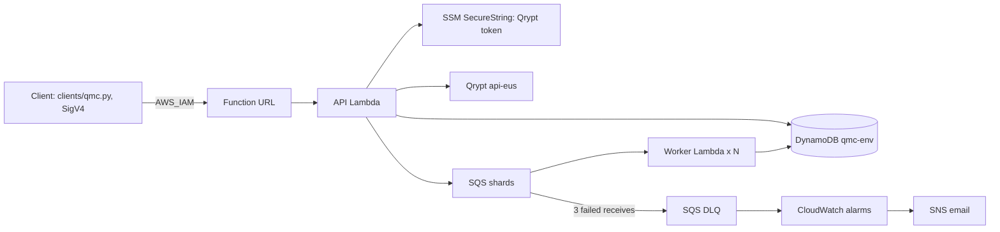
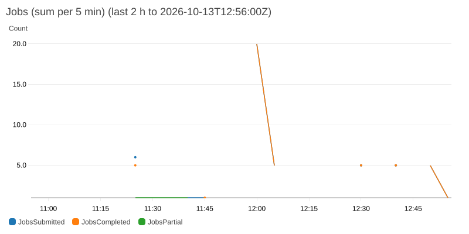
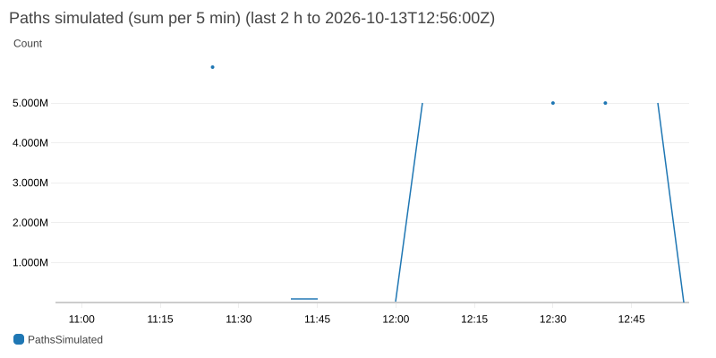
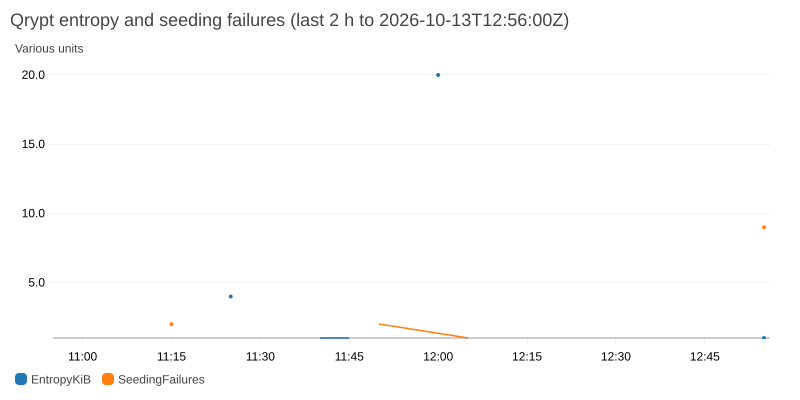
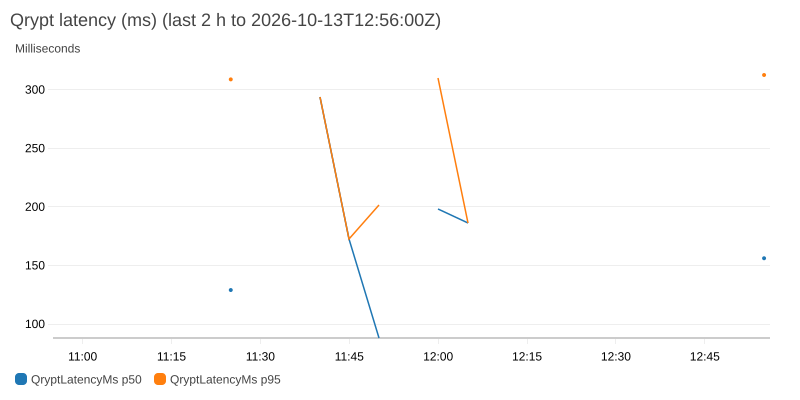
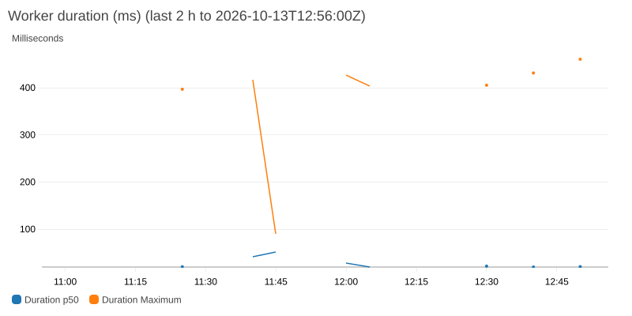
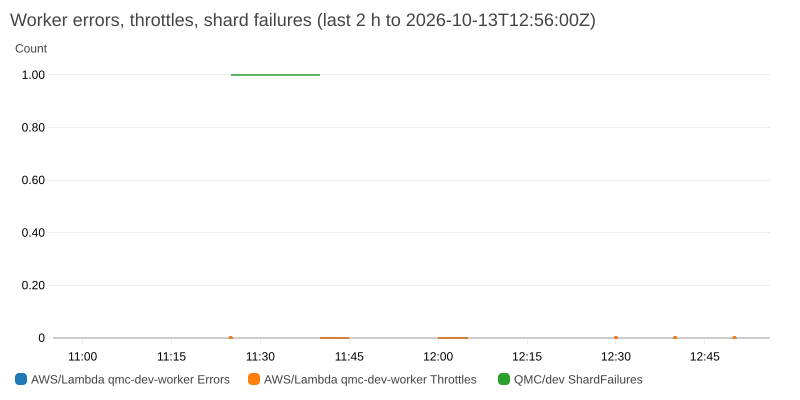
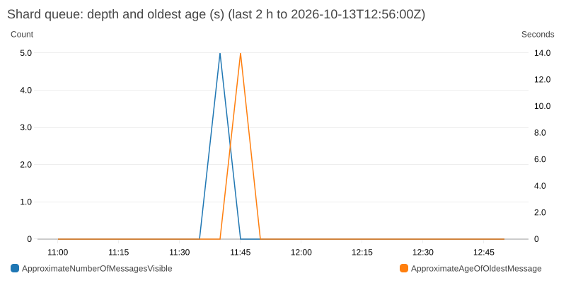
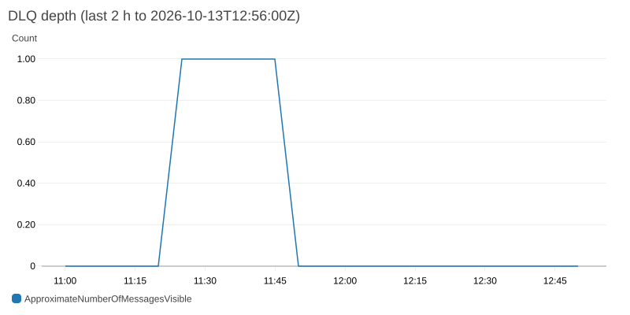

# Quantum-Seeded Monte Carlo

<!-- One-line description (≤ 120 characters; final wording at G4): -->
**Serverless Monte Carlo option pricing on AWS, seeded by Qrypt quantum entropy, replayable bit for bit, at $0/month.**

> **Status: skeleton (QMC-150).** Headings are final; text marked *TBD* is filled in from G1–G3 evidence (TEST_RESULTS, BENCHMARKS, `terraform state list`). Nothing below the quick-start has been run yet.
>
> **CI:** green on `main` `ea3820c` ([pipeline 52736](https://labs.gauntletai.com/jamesmcgirr/quantum-seeded-monte-carlo/-/pipelines/52736)): lint, unit (320 passed, 96% coverage), golden hash (7 passed, emulated amd64), Terraform validate, tflint, Checkov, and a guard against `data "aws_ssm_parameter"`. Also green on GitHub Actions, where the golden job runs natively on x86 ([run 38392842904](https://github.com/jrmcgirr/quantum-seeded-monte-carlo/actions/runs/38392842904), `d0af0b1`).

## What it does and for whom

It prices a European call under Black-Scholes by Monte Carlo. Each job is seeded from one 1 KiB block of Qrypt quantum entropy, split into shards that run in parallel on Lambda, and aggregated into an estimate, standard error and 95% confidence interval, shown next to the closed-form Black-Scholes price. Any completed job can be replayed from its stored seed, and the replay reports whether the result is bit-identical.

- **Analysts** get independent, non-reused seeds and a price with its error bars.
- **Operators** get one `terraform apply`, a $1 Budget, alarms and a clean `terraform destroy`.
- **Auditors and model-risk reviewers** get the seed's provenance and a byte-level replay of any reported number.

## Architecture



Every AWS resource, the submit and replay sequences, and the fail-closed branch: [docs/ARCHITECTURE.md](docs/ARCHITECTURE.md).

## Grader quick-start

*TBD (QMC-151, after G1): every command below is run from a clean clone during the rehearsal (QMC-157) before it is final.*

### Prerequisites

- An AWS account and CLI v2 credentials with admin rights in **us-east-2** (*TBD: note for other Regions*).
- Terraform ≥ 1.10, Python 3.13, [uv](https://docs.astral.sh/uv/), `make`. Docker is optional (only for `make test-golden`).
- If you sign in with `aws login`, Python tools need `botocore[crt]` to read those credentials; `make setup` installs it.
- A Qrypt **Entropy** token from [portal.qrypt.com](https://portal.qrypt.com).

### 0. Clone

```sh
git clone https://github.com/jrmcgirr/quantum-seeded-monte-carlo.git
cd quantum-seeded-monte-carlo
```

### 1. Configure AWS credentials

```sh
aws configure            # or aws login / SSO; Region us-east-2
aws sts get-caller-identity
```

### 2. Store the Qrypt token in SSM (out-of-band)

The token is created by the CLI, never passed to Terraform, so it never lands in Terraform state or the repo; Terraform only knows the parameter's name. `read -s` keeps it out of shell history and `ps`.

```sh
read -rs QRYPT_API_KEY
printf %s "$QRYPT_API_KEY" | aws ssm put-parameter --region us-east-2 \
  --name /qmc/qrypt-api-key --type SecureString --value file:///dev/stdin
unset QRYPT_API_KEY
```

### 3. Settings, build and deploy

*TBD: settings file location and contents from `infra/terraform.tfvars.example` (WS1), including `alert_email`.*

**Worker reserved concurrency.** Check your account's Lambda concurrency limit:

```sh
aws lambda get-account-settings --query AccountLimit.ConcurrentExecutions
```

If it is **110 or more**, set `worker_reserved_concurrency = 10`. AWS keeps 100 unreserved, so a reservation of 10 needs at least 110. If the limit is lower, which is common on new accounts, leave the setting unset (the default is `null`). Fan-out is still capped at 5 concurrent workers by the queue mapping's `maximum_concurrency` (D12, D40).

```sh
make setup
make build && make apply      # make apply runs make build
```

Confirm the SNS subscription email straight away: alarm emails are dropped until it is confirmed.

### 4. Submit a job and wait

```sh
uv run python clients/qmc.py submit --S0 100 --K 100 --r 0.05 --sigma 0.2 --T 1 --paths 1000000 --shards 10
uv run python clients/qmc.py wait <job_id>
```

`uv run` uses the project environment from `make setup`, which has botocore for SigV4 signing. *TBD: the full flag list from `clients/qmc.py --help` (WS2).*

### 5. Read the result and the Black-Scholes comparison

Example from the first live run (G1, 2026-10-13, job `5358ec35…`, `docs/ai-log/WS2.md`):

| Field | Value | Meaning |
| --- | --- | --- |
| `result.estimate` | 10.476167161519855 (`0x1.4f3cc2ea45059p+3`) | Monte Carlo price; the hex form is what replay compares |
| `result.std_error` | 0.014748685456949651 | Standard error over 1,000,000 paths |
| `result.ci95` | [10.447260269204925, 10.505074053834786] | 95% confidence interval |
| `reference.black_scholes` | 10.450583572185565 | Closed-form price |
| `reference.z_score`, `within_3se` | 1.735, `true` | Distance from Black-Scholes in standard errors |

*TBD: replace with the annotated output of the rehearsal run.*

### 6. Replay it

```sh
uv run python clients/qmc.py replay <job_id>
uv run python clients/qmc.py wait <replay_job_id>    # replay_check.bit_identical: true
```

### 7. Tear down

```sh
make destroy
```

*TBD: what to check afterwards (no `/aws/lambda/qmc-*` log groups, no SNS subscriptions left) and how to delete the SSM parameter.*

## Calling our deployed endpoint

*TBD (QMC-158): endpoint URL, which is kept up through grading and then destroyed, and the deployed `build_sha` as reported by `GET /health` at the rehearsal.*

The URL uses `AWS_IAM` auth. Graders receive an invoke-only access key for the IAM user `qmc-dev-grader` privately; it is never committed and will be deleted after grading.

```sh
export AWS_ACCESS_KEY_ID=… AWS_SECRET_ACCESS_KEY=…     # the grader key
export QMC_API_URL=<endpoint URL>
uv run python clients/qmc.py health
```

Or with `curl` alone:

```sh
curl --aws-sigv4 "aws:amz:us-east-2:lambda" --user "$AWS_ACCESS_KEY_ID:$AWS_SECRET_ACCESS_KEY" \
  -H 'content-type: application/json' "$QMC_API_URL/jobs" \
  -d '{"S0":100,"K":100,"r":0.05,"sigma":0.2,"T":1,"paths":1000000,"shards":10}'
```

## API reference

| Method and path | Purpose | Success |
| --- | --- | --- |
| `POST /jobs` | Validate, seed from Qrypt, record, enqueue | 202 |
| `GET /jobs` | Newest 50 jobs | 200 |
| `GET /jobs/{id}` | Progress, then the result and Black-Scholes reference | 200 |
| `POST /jobs/{id}/replay` | Re-run from the stored seed; reports `replay_check` | 202 |
| `GET /health` | DynamoDB and SSM reachability, deployed build sha | 200 / 503 |

*TBD: request fields and limits, the job view, and the error table (HANDOFF §5), checked against the deployed API.*

## How bit-identical replay works, and when it would not hold

*TBD: seed chain (Qrypt block → HKDF-SHA256 master seed → `SeedSequence(master, spawn_key=(i,))` → `PCG64DXSM`; 256-bit stored seed, 128-bit RNG state); pinned NumPy, x86_64, `NPY_DISABLE_CPU_FEATURES`, fixed chunk size, `math.fsum`, hex-float storage; the fingerprint and what a mismatch means; replay ×20 evidence from TEST_RESULTS.*

**Replay ×20** (QMC-146, build `855e8d6`, `docs/TEST_RESULTS.md`): `make replay-check N=20` replayed the e2e reference job (1M paths, 10 shards) 20 times, in four batches of 5 spaced at least 10 minutes apart. **All 20 were bit-identical**, with `fingerprint_match` true and no shard diffs. The run covered 2 CPU model strings (`Intel(R) Xeon(R) Processor` and `… @ 2.50GHz`) and 17 distinct worker execution environments.

First live evidence (G1, 2026-10-13): WS4's `make e2e` replayed job `edaff921…` bit-identically on Lambda: 10 shards, no diffs, `fingerprint_match: true`, across two reported Xeon CPU models (`docs/TEST_RESULTS.md`). WS2's replay `f1df7275…` of job `5358ec35…` returned `bit_identical: true`, `estimate_equal: true`, 10 shards compared, no shard diffs, `fingerprint_match: true` (`docs/ai-log/WS2.md`).

## Guardrails: Budget, alarms, limits and custom metrics

*TBD: $1 Budget, seven alarms, validation limits and concurrency caps, with the deployed values. Custom metrics: Terraform sets the namespace (`METRICS_NAMESPACE`) and creates the alarms and the dashboard; the metrics themselves come from EMF log lines, so no role needs the `cloudwatch:PutMetricData` wildcard.*

**Dashboard `qmc-dev`** (all 8 custom metrics plus Lambda and SQS metrics). Rendered read-only with `AWS_PROFILE=qmc uv run python docs/images/render_dashboard.py --hours 2` at 2026-10-13 12:56Z, after WS4's replay ×20:

| | |
| --- | --- |
|  |  |
|  |  |
|  |  |
|  |  |

The DLQ depth of 1 (about 11:25–11:45Z) and the shard failure come from the forced-failure drill. Alarm states at render time are in [docs/images/dashboard-alarms.md](docs/images/dashboard-alarms.md): all 7 were OK.

**Qrypt rate limit.** At most **10** Qrypt calls per aligned 10 s window: ≤ 1/s on average and ≤ 20 in any rolling 10 s, under Qrypt's limit of 30. The trial key is rated 1 call/s (D10, contract change 004). A burst of 40 concurrent submits is expected to give 10 × 202 and 30 × 429 `ENTROPY_RATE_LIMITED`, each with `Retry-After`. *TBD: WS4's re-run after the 004 apply.* The earlier run under the old cap of 15 (build `d0af0b1`, `docs/TEST_RESULTS.md`) gave 15 × 202 and 25 × 429, with at most 15 Qrypt calls in any rolling 10 s.

## Why the worker fails closed at init

*TBD: the SIMD self-check raises at import when NumPy would dispatch `exp` to AVX-512 (a different result by 1 ULP), because no result is better than a non-reproducible one; handler code otherwise never raises.*

## Qrypt token expiry

*TBD: date (must cover the grading window).*

## Security

*TBD: summary.* Details in [docs/SECURITY.md](docs/SECURITY.md).

## Limitations and what we left out

*TBD: Step Functions, PENDING_ENTROPY, ephemeral environments, portfolio VaR, CI deploys, and why (D21); anything cut at G3.*

## Documents

| Document | What it is |
| --- | --- |
| [docs/ARCHITECTURE.md](docs/ARCHITECTURE.md) | Architecture diagram: every AWS resource and data flow |
| [docs/COST.md](docs/COST.md) | Cost note: free-tier arithmetic and the Budget screenshot |
| [docs/SECURITY.md](docs/SECURITY.md) | Secrets, IAM, encryption, logging |
| [docs/BENCHMARKS.md](docs/BENCHMARKS.md) | Measured latency, wall clock and apply time |
| [docs/TEST_RESULTS.md](docs/TEST_RESULTS.md) | Test and drill evidence |
| [docs/DECISIONS.md](docs/DECISIONS.md) | Decisions with alternatives and reasons |
| [AI_USAGE.md](AI_USAGE.md) | AI usage disclosure |
| [docs/PRIMER.md](docs/PRIMER.md) | Research report behind the decisions |
| [docs/HANDOFF.md](docs/HANDOFF.md) | Engineering contract |
| Demo video | *TBD (≤ 5 min)* |
