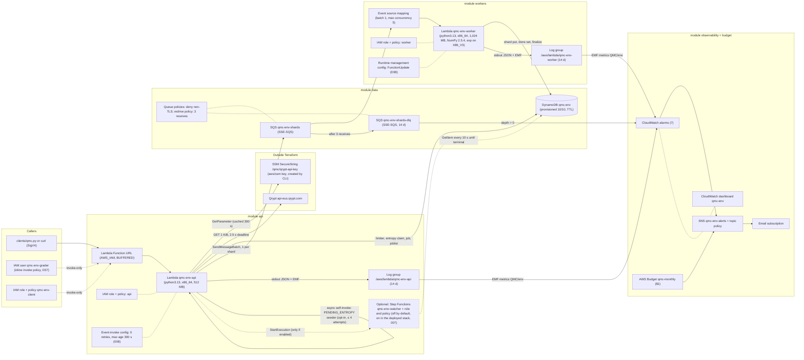
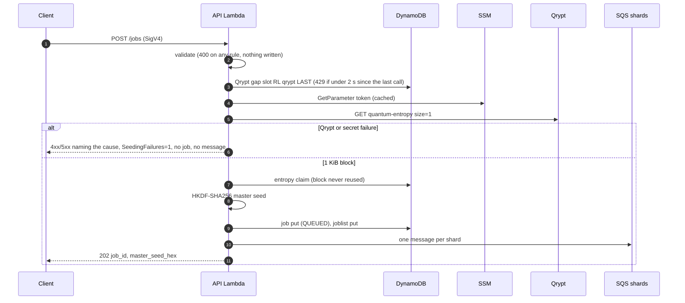
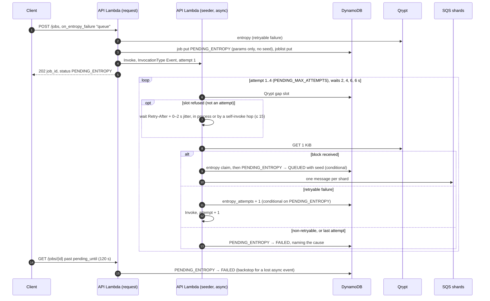
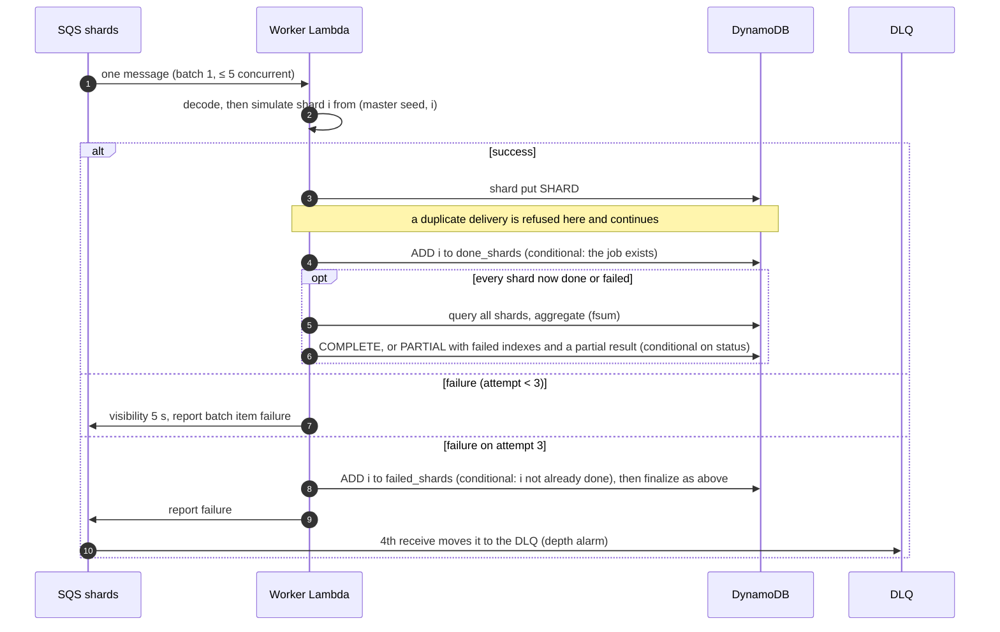
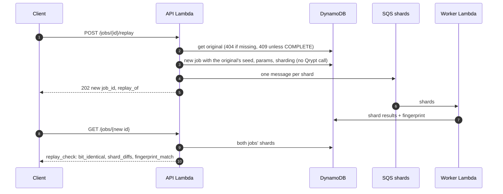

# Architecture

> Drawn from HANDOFF §8 (QMC-150), then reconciled with `terraform state list` from the fresh-clone rehearsal (QMC-152, 2026-10-15, `main` `a5b9ec0`): every one of the 37 managed resources appears below.

All resources are in **us-east-2** and named `qmc-<env>` (`env` = `dev`), except the account-wide Budget `qmc-monthly`.

## Resources and data flow

Dashed outline: the Step Functions watcher and its role exist only with `enable_step_functions = true` (contract change 007). WS4's drill switched it on (2026-10-13 18:16Z): a COMPLETE job's execution SUCCEEDED and a PARTIAL job's FAILED with `JobNotComplete` (docs/TEST_RESULTS.md). It is **on in the final deployed stack**: at the rehearsal both executions, named by job id (`0aaa055f…` and its replay `9dbf6846…`), SUCCEEDED in 10.2 s (`ListExecutions`, 16:11:51–16:12:05Z).

### Reconciled with `terraform state list`

The rehearsal's state list has 52 entries: **37 managed resources**, matching "37 added" from the apply, and 15 data sources.

| Module | Managed resources in state | In the diagram as |
| --- | --- | --- |
| `api` (13) | `aws_lambda_function.api`, `aws_lambda_function_url.api`, `aws_lambda_function_event_invoke_config.api`, `aws_cloudwatch_log_group.api`, `aws_iam_role.api` + `aws_iam_role_policy.api`, `aws_iam_role.client` + `aws_iam_role_policy.client`, `aws_iam_user.grader[0]` + `aws_iam_user_policy.grader[0]`, `aws_sfn_state_machine.watcher[0]`, `aws_iam_role.watcher[0]` + `aws_iam_role_policy.watcher[0]` | URL, APIF, EIC, APIL, APIR, CR, GU, SFN |
| `data` (6) | `aws_dynamodb_table.main`, `aws_sqs_queue.shards`, `aws_sqs_queue.dlq`, `aws_sqs_queue_policy.shards`, `aws_sqs_queue_policy.dlq`, `aws_sqs_queue_redrive_policy.shards` | DDB, SQ, DLQ, QP |
| `workers` (6) | `aws_lambda_function.worker`, `aws_lambda_event_source_mapping.shards`, `aws_lambda_runtime_management_config.worker`, `aws_cloudwatch_log_group.worker`, `aws_iam_role.worker` + `aws_iam_role_policy.worker` | WF, ESM, RMC, WL, WR |
| `observability` (11) | `aws_cloudwatch_metric_alarm.this` × 7 (`api-errors`, `dlq-depth`, `jobs-partial`, `queue-age`, `seeding-failures`, `worker-errors`, `worker-throttles`), `aws_cloudwatch_dashboard.main`, `aws_sns_topic.alerts`, `aws_sns_topic_policy.alerts`, `aws_sns_topic_subscription.email` | ALM, DASH, SNS, SUB |
| `budget[0]` (1) | `aws_budgets_budget.monthly` | BUD |

The 15 data sources create nothing: `aws_caller_identity` (×2), `aws_region` (×2), and 11 `aws_iam_policy_document`s that render the role, user, queue and topic policies above (`api`, `assume`, `client_assume`, `invoke`, `watcher[0]`, `watcher_assume[0]`, `tls_only["shards"]`, `tls_only["dlq"]`, `alerts`, and the worker's `assume` and `worker`). There is no `aws_lambda_permission`: with `AWS_IAM` auth, the callers' identity policies grant `lambda:InvokeFunctionUrl`. The dashboard was built, not cut. Outside Terraform: the SSM parameter (created by CLI, I6) and the grader's access key (created by CLI, D44).

## Submit, including the fail-closed branch

## Opt-in PENDING_ENTROPY (contract change 008)

A submit with `"on_entropy_failure": "queue"` that hits a **retryable** entropy failure (our 429 `ENTROPY_RATE_LIMITED`, a Qrypt 429 or 5xx, a timeout or a network error) is parked instead of rejected, if fewer than `MAX_PENDING_ENTROPY` (10) jobs are pending. Token, quota and bad-response failures still reject at once, writing nothing.

Every transition is conditional on `status = PENDING_ENTROPY`, so the seeder and the GET backstop cannot both win. Lambda never retries the async event (event-invoke config: 0 retries, dropped after 300 s). A refused limiter slot does not count as an attempt (MR !57). Without that rule, seeders woken together lost the slot to each other and 5 of 10 jobs in WS4's first burst failed. With it, all 10 completed (docs/TEST_RESULTS.md).

## Shard processing and finalize

The worker never raises: it returns `batchItemFailures`, so only the failed message is retried. Each finalize write is conditional; if another worker finalized first, it re-decides once from the returned item and stops. A message that cannot be decoded has no job to mark and goes to the DLQ after 3 receives (HANDOFF §7.6).

## Replay

