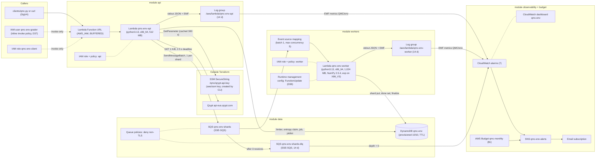
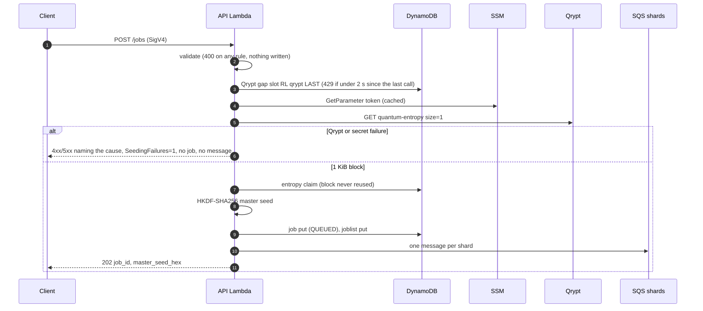
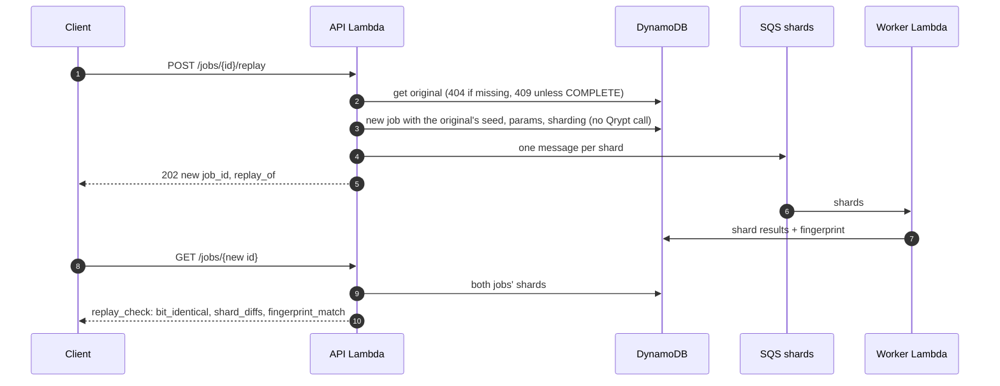

# Architecture

> **Draft (QMC-150),** drawn from HANDOFF §8 before anything is deployed. QMC-152 checks it against `terraform state list` after G2: every resource in state must appear here.

All resources are in **us-east-2** and named `qmc-<env>` (`env` = `dev`), except the account-wide Budget `qmc-monthly`.

## Resources and data flow

*TBD (QMC-152): reconcile with `terraform state list` (data sources, `aws_iam_policy_document`s, the redrive policy, the topic policy, the Function URL permission) and mark the dashboard as cut if QMC-118 is cut.*

## Submit, including the fail-closed branch

## Shard processing and finalize

*TBD (QMC-152): worker sequence: shard put (duplicate = continue), `ADD done_shards`, last shard aggregates and finalizes COMPLETE or PARTIAL; failure path to the DLQ.*

## Replay

