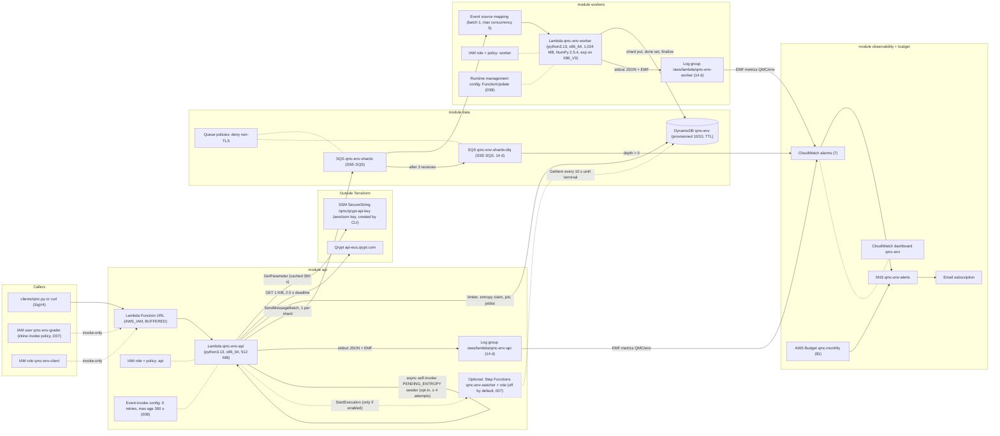
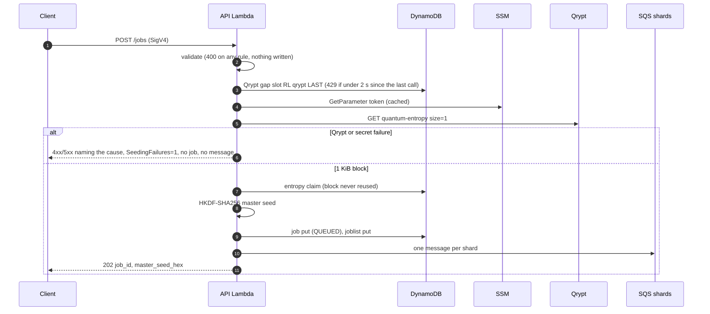
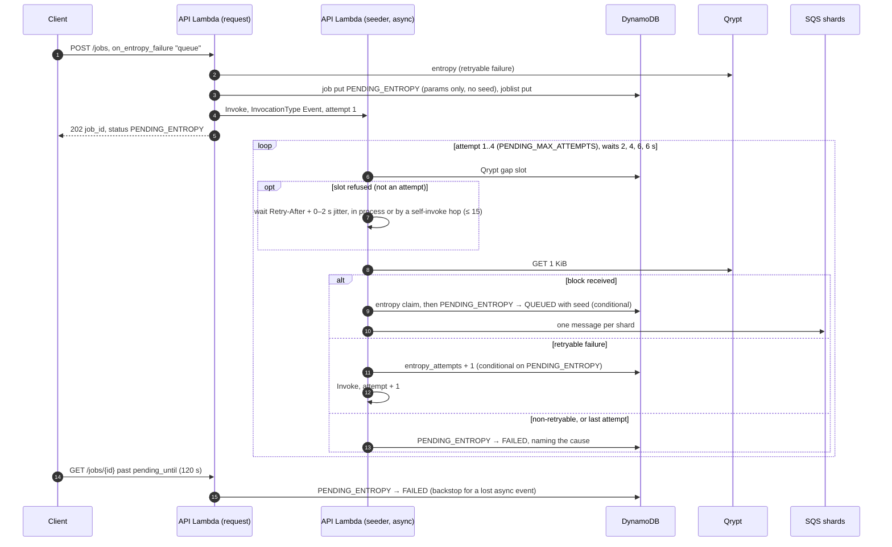
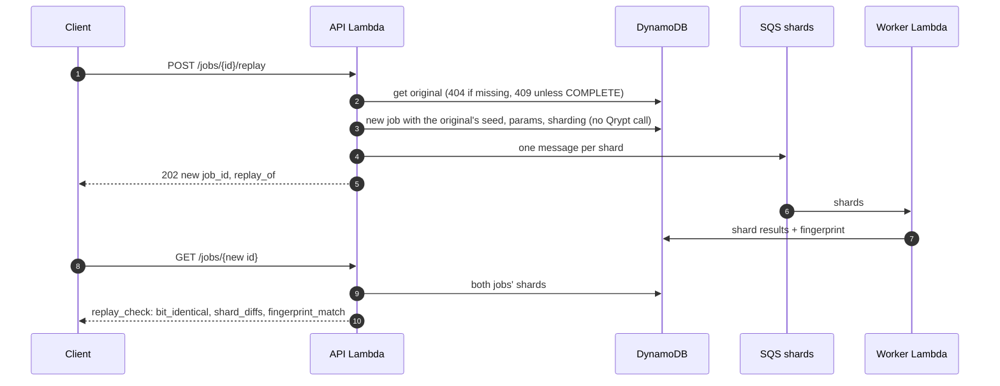

# Architecture

> **Draft (QMC-150),** drawn from HANDOFF §8 before anything is deployed. QMC-152 checks it against `terraform state list` after G2: every resource in state must appear here.

All resources are in **us-east-2** and named `qmc-<env>` (`env` = `dev`), except the account-wide Budget `qmc-monthly`.

## Resources and data flow

Dashed outline: the Step Functions watcher and its role exist only with `enable_step_functions = true` (contract change 007). WS4's drill switched it on (18:16Z): a COMPLETE job's execution SUCCEEDED and a PARTIAL job's FAILED with `JobNotComplete`. It was switched off again at 19:30Z, and `ListStateMachines` returns none (docs/TEST_RESULTS.md).

*TBD (QMC-152): reconcile with `terraform state list` (data sources, `aws_iam_policy_document`s, the redrive policy, the topic policy, the Function URL permission) and mark the dashboard as cut if QMC-118 is cut.*

## Submit, including the fail-closed branch

## Opt-in PENDING_ENTROPY (contract change 008)

A submit with `"on_entropy_failure": "queue"` that hits a **retryable** entropy failure (our 429 `ENTROPY_RATE_LIMITED`, a Qrypt 429 or 5xx, a timeout or a network error) is parked instead of rejected, if fewer than `MAX_PENDING_ENTROPY` (10) jobs are pending. Token, quota and bad-response failures still reject at once, writing nothing.

Every transition is conditional on `status = PENDING_ENTROPY`, so the seeder and the GET backstop cannot both win. Lambda never retries the async event (event-invoke config: 0 retries, dropped after 300 s). A refused limiter slot does not count as an attempt (MR !57). Without that rule, seeders woken together lost the slot to each other and 5 of 10 jobs in WS4's first burst failed. With it, all 10 completed (docs/TEST_RESULTS.md).

## Shard processing and finalize

*TBD (QMC-152): worker sequence: shard put (duplicate = continue), `ADD done_shards`, last shard aggregates and finalizes COMPLETE or PARTIAL; failure path to the DLQ.*

## Replay

