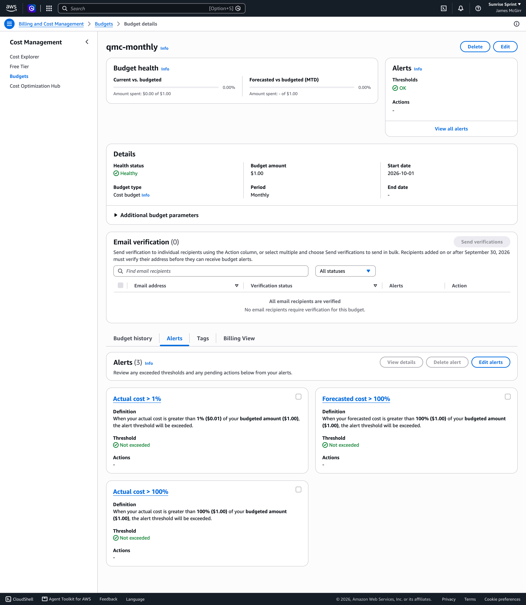

# Cost note

**$0.00 a month** at rest and at 100 jobs a day of 1,000,000 paths: every service stays inside its AWS **always-free** allowance. The measurements below come from the deployed `dev` stack in us-east-2 on 2026-10-13. *TBD* marks what is still to be measured before G4.

## Account plan

The account is on the AWS **Paid plan** (D25; switched on Day 0, `aws freetier get-account-plan-state` → `PAID`, `docs/ai-log/WS0.md`).

This matters because, since 15 July 2025, a new account on the **Free plan** runs on credits. On that plan, any usage beyond the always-free allowances quietly uses up credits instead of appearing as a charge, which would hide a broken cost design ([AWS Free Tier FAQ](https://aws.amazon.com/free/free-tier-faqs/)). On the Paid plan the always-free allowances still apply, so a $0 bill is real evidence that the design stays inside them, and the $1 Budget alerts at the first cent.

## Measured inputs

| Input | Measured | Source |
| --- | --- | --- |
| Worker `Duration`, average per invocation | 52–88 ms (hourly averages), max 626 ms | `AWS/Lambda Duration`, `qmc-dev-worker`, `GetMetricStatistics`, hourly buckets 10:29–13:29Z |
| Worker cold start | `Init Duration` p50 777 ms, max 843 ms (38 cold starts) | [BENCHMARKS.md](BENCHMARKS.md) |
| API `Duration`, average per invocation (submits, polls, health, drills) | 46–479 ms (hourly averages), max 1,414 ms | `AWS/Lambda Duration`, `qmc-dev-api`, same query |
| API cold start | `Init Duration` p50 375 ms, max 520 ms (137 cold starts) | [BENCHMARKS.md](BENCHMARKS.md) |
| Shard queue empty receives (idle polling by the event source mapping) | 909 and 938 per full hour | `AWS/SQS NumberOfEmptyReceives`, `qmc-dev-shards`, same query |
| DLQ empty receives | 0 (the DLQ is never mapped) | `AWS/SQS NumberOfEmptyReceives`, `qmc-dev-shards-dlq` |
| Log ingestion | worker ≈ 1,142 B per invocation, API ≈ 1,297 B per invocation | `AWS/Logs IncomingBytes` ÷ invocations, 12:29Z hour (288,964 B / 253; 273,661 B / 211) |
| Custom metrics | 8, all with no dimensions | `ListMetrics`, namespace `QMC/dev` |
| Alarms | 7 metric alarms (all in the Region) | `DescribeAlarms` |
| DynamoDB | `PROVISIONED` 10 RCU / 10 WCU, no GSI, AWS-owned key | `DescribeTable` |

The idle-polling rate of about 940 per hour matches the design estimate: 5 pollers, each with a 20 s long poll, is 15 receives a minute, about 900 an hour. The queue has been up only a few hours. *TBD: re-measure `NumberOfEmptyReceives` over a full idle 24 h (R7).*

## Free-tier arithmetic at 100 jobs a day of 1M paths

**Workload per 30-day month** (PRIMER's model):

- 3,000 jobs, plus 10% replays: 3,300 jobs.
- 10 shards each: 33,000 worker invocations.
- 10 status polls per job: 33,000.
- `GET /health` every 5 minutes: 8,640.
- So the API serves 3,300 + 33,000 + 8,640 = 44,940 invocations.

**Durations:**

- **Measured case:** the worst hourly averages above.
- **Worst case:** every invocation is a cold start at the **maximum** measured init and duration. This is far more than will happen, and it still fits.

| Service | Monthly usage | Always-free allowance | Share | Source |
| --- | --- | --- | --- | --- |
| Lambda requests | 33,000 + 44,940 = **77,940** | 1,000,000 | 7.8% | [Lambda pricing](https://aws.amazon.com/lambda/pricing/) |
| Lambda compute, measured case | worker 33,000 × 1 GB × 0.0885 s ≈ 2,920; API 44,940 × 0.5 GB × 0.479 s ≈ 10,760; **≈ 13,700 GB-s** | 400,000 GB-s | 3.4% | same |
| Lambda compute, worst case (every call cold, max init + max duration) | worker 33,000 × 1 GB × (0.843 + 0.626) s ≈ 48,500; API 44,940 × 0.5 GB × (0.520 + 1.414) s ≈ 43,500; **≈ 92,000 GB-s** | 400,000 GB-s | 23% | same; init is billed as duration |
| SQS requests | idle polling 938 × 730 h ≈ 684,700; receives ≈ 33,000; deletes ≈ 33,000; `SendMessageBatch` 3,300; **≈ 754,000** | 1,000,000 | **75%** (the binding limit) | [SQS pricing](https://aws.amazon.com/sqs/pricing/) |
| DynamoDB capacity | provisioned 10 RCU + 10 WCU (no autoscaling, no GSI) | 25 RCU + 25 WCU per Region, provisioned only | 40% of capacity, whatever the request count | [DynamoDB pricing](https://aws.amazon.com/dynamodb/pricing/provisioned/) |
| DynamoDB storage | *TBD: `TableSizeBytes` once DynamoDB refreshes it (about every 6 h)* | 25 GB | | same |
| KMS requests (`aws/ssm` decrypts) | ≤ one per submit, so ≤ 3,300. The token is cached 300 s, `/health` reads the parameter without decryption, and SSE-SQS and the AWS-owned DynamoDB key make no KMS calls | 20,000 | ≤ 17% | [KMS pricing](https://aws.amazon.com/kms/pricing/) |
| CloudWatch custom metrics | 8 | 10 | 80% | [CloudWatch pricing](https://aws.amazon.com/cloudwatch/pricing/) |
| CloudWatch alarms (standard resolution) | 7 | 10 | 70% | same |
| CloudWatch dashboards | 1 | 3 | 33% | same |
| CloudWatch Logs ingestion | worker 33,000 × 1,142 B ≈ 37.7 MB; API 44,940 × 1,297 B ≈ 58.3 MB; **≈ 96 MB** (14-day retention) | 5 GB | 1.9% | same |
| SNS | a few alarm and budget emails | 1,000 emails | ≈ 0% | [SNS pricing](https://aws.amazon.com/sns/pricing/) |
| SSM Parameter Store | 1 standard SecureString | standard parameters are free | 0 | [Systems Manager pricing](https://aws.amazon.com/systems-manager/pricing/) |
| AWS Budgets | 1 cost budget | budget monitoring is free | 0 | [Budgets pricing](https://aws.amazon.com/aws-cost-management/aws-budgets/pricing/) |
| **Total** | | | | **$0.00** |

Compute is nowhere near the limit. Even the worst case leaves room for about 4 times the load. The binding allowance is SQS, and it is idle polling, not jobs, that uses it. That is why there is exactly one event source mapping and the DLQ is never mapped: a second mapping would add another ≈ 685k requests and go over 1M.

Qrypt is outside AWS. The trial key is free, and each submit spends 1 KiB of its monthly quota.

## At rest

With no jobs, the only recurring usage is:

- Idle polling: ≈ 685k SQS requests a month, 68% of the allowance.
- The `/health` checks, if anything calls them.
- Log storage that expires after 14 days.

Nothing is billed per hour: no NAT, load balancer, EC2, RDS or API Gateway. Provisioned DynamoDB capacity inside 25/25 is free.

## The rules that keep it at $0

| Rule | Why |
| --- | --- |
| Exactly **one** SQS event source mapping; never map the DLQ | Idle polling is ≈ 685k requests a month per mapping (measured rate above); two would exceed the 1M free requests |
| DynamoDB `PROVISIONED` 10/10, no autoscaling, no GSI, PITR off | Only provisioned capacity is free (25/25 per account per Region, shared by every table and index); PITR has no free tier |
| ≤ 10 custom metrics and ≤ 10 alarms across every environment, metrics with no dimensions | The free tier counts per account, and each dimension combination is a separate metric |
| No customer-managed KMS keys | $1 a month each, the whole Budget |
| 14-day log retention on every log group, created by Terraform | "Never expire" grows storage forever; Lambda's auto-created groups survive destroy |
| No Step Functions, NAT, ALB, EC2, RDS, API Gateway, Secrets Manager, S3, ECR or X-Ray | Not always-free, or not needed |
| `MAX_PATHS`, `MAX_PATHS_PER_SHARD`, worker reserved concurrency (10) and `maximum_concurrency` (5) | Stop a runaway request from turning into a runaway bill |
| Qrypt limiter (one call per 2 s, D10) | Protects the external quota |
| $1 monthly Budget with an alert at the first cent | Backstop: any spend at all sends an email |

**One known non-free call:** CloudWatch's free API requests do not cover `GetMetricData` or `GetMetricWidgetImage`, which are billed per metric requested. Rendering the dashboard images (`docs/images/render_dashboard.py`) made 16 `GetMetricWidgetImage` calls covering about 30 metrics, about $0.0006 at list price. The measurements in this note used `GetMetricStatistics`, which is covered. The Budget itself reported month-to-date actual spend of **$0.0** (`DescribeBudget` `CalculatedSpend.ActualSpend`, 2026-10-13 after 13:43Z). *TBD: re-check before submission.*

## Budget configuration

Console screenshot of the `qmc-monthly` Budget (Billing and Cost Management → Budgets, 2026-10-13, after WS1's apply of MR !24):

- **Configuration:** a $1.00 monthly cost budget, health **Healthy**, **$0.00** spent of $1.00.
- **Alerts:** three, none exceeded. Actual cost > 1% ($0.01), actual cost > 100% and forecasted cost > 100%.
- **Delivery:** "Email verification (0)". The Budget has no direct email recipients, because its alerts publish to the `qmc-dev-alerts` SNS topic (D43). `DescribeSubscribersForNotification` confirms one SNS subscriber per alert.
