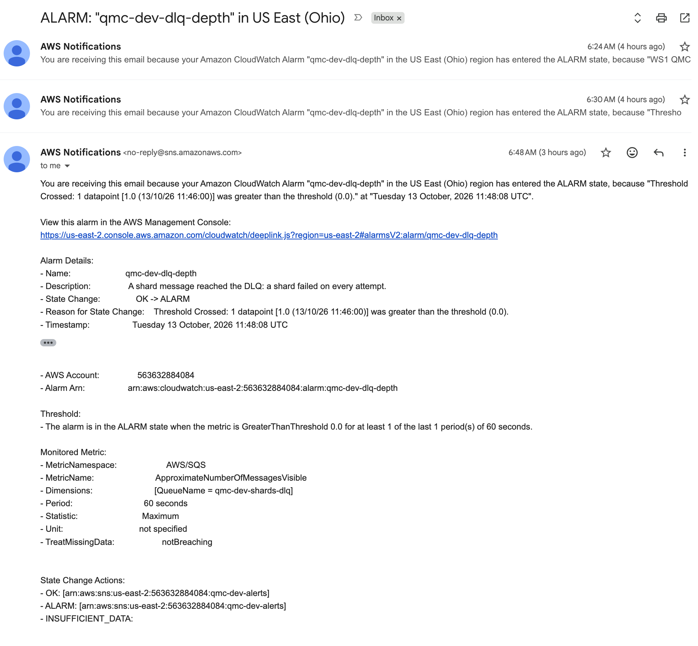

# Test results (WS4)

Evidence for every row of HANDOFF §11. Each entry names the command, the commit or deployment it ran against, and its output. **Pending** means it has not run yet. Final form at the G3 commit (QMC-148).

## Summary

| HANDOFF §11 requirement | Evidence | Result |
| --- | --- | --- |
| Core 1: submit returns an id; record has seed, params, QUEUED | `tests/integration/test_submit.py` (moto) | PASS (local, 2026-10-13) |
| Core 2: distinct, reproducible shard seeds | `tests/correctness/test_seed_independence.py`, `tests/core/test_seeds.py` | PASS; max \|corr\| 0.02805 < 0.05 |
| Core 3: progress then COMPLETE | `make e2e` | PASS (c768aea): `RUNNING:8/10 → COMPLETE:10/10` |
| Core 4: within 3 SE at 1M paths | `tests/correctness/test_closed_form.py` | PASS, z = −2.748 (frozen seed; see below) |
| Core 5: bit-identical replay | `make test-golden`, `tests/integration/test_pipeline.py::test_replay_is_bit_identical`, `make e2e`, `make replay-check N=20` | golden PASS (emulated GitLab 52736, native x86 GitHub run 38392842904, Lambda per-shard), integration PASS, `make e2e` replay bit-identical PASS (c768aea); replay ×20 **20/20 bit-identical** (855e8d6), 2 CPU model strings, 17 execution environments |
| Core 6: forced failure → DLQ alarm + email | `make warm-dlq`, `make force-failure ARGS="--purge-first --duplicate"` | PASS (f40a083): PARTIAL [3] +13 s, DLQ 1 +23 s, OK→ALARM +237 s, SNS publish OK; **alarm email received** ([screenshot](images/dlq-alarm-email.png)) |
| Fail-closed seeding | `tests/integration/test_submit.py::test_qrypt_failure_rejects_and_writes_nothing`, WS2 unit tests; deployed secret-failure check (below); deployed decoy-token drill | integration PASS; deployed SECRET_UNAVAILABLE PASS (c768aea); decoy drill 11:51: fails closed, but the cause was wrong (Qrypt 403 → QRYPT_QUOTA_EXHAUSTED); **fixed by contract change 003 (MR !9)**; re-run 12:08 PASS (855e8d6): 503 QRYPT_FORBIDDEN, alarm OK→ALARM 12:09:32Z, SNS OK |
| Duplicate SQS delivery | `test_every_message_delivered_twice`, `test_crash_between_shard_put_and_mark_done`; `make force-failure ARGS=--duplicate` | integration PASS; deployed PASS (f40a083, `duplicate_delivery` logged, result and n unchanged) |
| Worker failure → PARTIAL | `test_forced_failure_ends_partial`, `test_reaper_marks_missing_shard_partial_and_partial_is_final`; `make force-failure` | integration PASS; deployed PASS (f40a083) |
| Lambda timeout bound | `tests/deployed` paths-per-shard 400; worker shard duration | PASS: paths-per-shard 400; 100k-path shard 3–5 ms vs the 10 s timeout |
| Burst vs 30 req/10 s | `make burst` | **006 (e77a626): PASS 11/11**: 1 × 202, 39 × 429 with Retry-After 1–2, no Qrypt 429, LAST item matches; steady spot check: 5 calls 2.49–3.03 s apart, all 200. Earlier, under 005: **PASS under HANDOFF 1.12 §11 (James's decision, R24)** (6dcb3c2): 1 × 202, 38 × 429 (Retry-After 1), 1 × 503 QRYPT_RATE_LIMITED (Qrypt 429 on a boundary-crossing call, failed closed, nothing written); max 2 Qrypt calls per 10 s. Cap 10 re-run (f3873f8): our limit held (10 slots, ≤ 10 calls/10 s), but **Qrypt answered 9 of 10 with 429**, so 1 × 202, 30 × 429, 9 × 503 QRYPT_RATE_LIMITED (finding below). Earlier PASS (d0af0b1): 40 concurrent → 15 × 202, 25 × 429 with Retry-After; 15 limiter slots in the window; max 15 Qrypt calls in any rolling 10 s; SampleCount = log lines |
| Cost runaway | `tests/deployed` MAX_PATHS 400; live configuration (read-only Lambda API, c1ab7ed) | PASS: MAX_PATHS 400 (c768aea). Live: exactly **1** event source mapping on `qmc-dev-worker` (`MaximumConcurrency` 5, batch 1, `ReportBatchItemFailures`), worker **reserved concurrency 10**; API env `MAX_PATHS` 10000000, `MAX_SHARDS` 50, `MAX_PATHS_PER_SHARD` 1000000, `QRYPT_MIN_GAP_MS` 2000 |
| Invalid inputs | `tests/api/test_validation.py` (WS2); `tests/deployed/test_edge_cases.py` | PASS (deployed, c768aea) |
| Clean teardown, no drift | `make drift-check` (integrator) | **PASS after a fix** (372583c → c1ab7ed): plan 0 → destroy blocked by the SCP (FINDING, fixed by MR !28) → destroy finished → **0 orphans** → apply from empty **65 s** → `e2e --fresh` 12/12 → plan 0 |
| Empty / first run | `test_fresh_deployment_lists_no_jobs`; `make e2e ARGS=--fresh` | integration PASS; deployed after apply from empty (c1ab7ed): `GET /jobs` → `[]` PASS, unknown id → 404 PASS |
| Benchmarks | `make bench` → `docs/BENCHMARKS.md` | PASS (6dcb3c2): warm p95 301 ms (< 800); 1M paths 0.18–0.46 s server-side (< 60 s); 2 Qrypt 429 → 503 at 1.5 s pacing (R24); apply from empty 65 s; idle cold submit 2.4 s client / 1.6 s server (reported separately) |
| IAM completeness (QMC-105) | WS0's `iam_guard` allow-list fixture (`tests/conftest.py`, self-tested in `tests/core/test_iam_guard.py`), used by `tests/api/*`, `tests/worker/*` and every `tests/integration` handler call | PASS: CI `unit` job, 320 passed (pipeline 52736). Any AWS operation outside HANDOFF §8.3 fails the test, even one a handler swallowed |
| Coverage ≥ 80% | GitLab CI pipeline 52736 `unit` job (main ea3820c) | PASS: 96.20% total (gate 80%), qmc_core 100.00% (gate 90%) |

## CI (GitLab pipeline 52736, main ea3820c)

All 7 jobs succeeded: `ssm-data-source-guard`, `lint`, `checkov`, `tflint`, `terraform`, `golden`, `unit`. The `unit` job log shows `320 passed, 25 deselected`, `Required test coverage of 80% reached. Total coverage: 96.20%`, then a qmc_core-only run with `207 passed`, `Required test coverage of 90% reached. Total coverage: 100.00%`.

## Stretch: antithetic variates (QMC-108, #48) and cost attribution (QMC-126, #49), build 61d8b42, 2026-10-13 16:23Z

`AWS_PROFILE=qmc uv run python tools/antithetic_drill.py --plain 56b4a94b62c048ec9f46cbcd298ca454`. Antithetic job `166f446d9669459294ca69e125a1a097`, replay `e565b04f8a134168a37f226a6249cb55`. Qrypt: 1 KiB.

| check | result | detail |
| --- | --- | --- |
| submit antithetic 1M/10 → 202                           | PASS | 166f446d9669459294ca69e125a1a097 |
| COMPLETE                                                | PASS | COMPLETE |
| variance_reduction antithetic, n = 500,000 pairs        | PASS | antithetic n=500000 |
| within 3 SE of Black-Scholes                            | PASS | estimate=10.442006219489919 se=0.010397445315739301 z=-0.8249480939959117 |
| SE below the plain job's at equal paths                 | PASS | antithetic 0.0103974 / plain 0.0147019 = 0.707 |
| replay bit-identical                                    | PASS | e565b04f8a134168a37f226a6249cb55 shards=10 diffs=[] |
| REPORT lines found (10 worker invocations + the submit) | PASS | worker 10 (request ids 10), api 1 |
| cost_estimate GB-s within ±10% of REPORT GB-s           | FAIL | estimate 0.473 vs REPORT 2.381035 (worker 2.115620 + submit 0.265415) |

7/8 passed

**Antithetic: PASS.**
- Deployed: 500,000 pairs, z = −0.825, SE 0.0103974 = **0.707 × the plain 1M job's SE** (0.0147019), i.e. about half the variance at equal paths. The local closed-form test gives the same ratio (0.010395 / 0.014693 = 0.707).
- Replay bit-identical (10 shards, 0 diffs).
- Real Lambda shards vs recompute (`tools/shard_crosscheck.py`, fixed to pass `variance_reduction` and to convert pairs to paths):
  - native arm64: `166f446d…: 10/10 shards bit-identical`;
  - Lambda image under emulated x86 (X86_V3): `10/10 shards bit-identical`.
- Closed form (local, seed label committed in 12ac8a7 before the implementation existed): z = +0.868.
- Golden antithetic shard: emulated x86 (`make test-golden`), native arm64, and native x86_64 (GitHub Actions run [38429804576](https://github.com/jrmcgirr/quantum-seeded-monte-carlo/actions/runs/38429804576), main 61d8b42, `golden` success on ubuntu-24.04) all agree. **Confirmed.**

**Cost attribution: FAIL on the deployed spot check (finding, reported to WS0). To be fixed by contract change 009 (MR !46): shards gain `invocation_ms` and `init_ms`, the estimate uses them, and the acceptance becomes worker GB-s within ±15% of REPORT Billed Duration × memory. Re-run after 009: cold PASS (0.856×), warm FAIL (0.170×). See below.** `cost_estimate.lambda_gb_seconds` = 0.473, against **2.381 GB-s from the job's own REPORT lines** (10 worker invocations, found by `job_id` → `request_id`, plus the submit): 5× low. Per invocation:

| | shard `duration_ms` (what the estimate uses) | worker REPORT `Duration` |
| --- | --- | --- |
| 5 warm invocations | 2 ms each | 18.6–59.7 ms |
| 5 invocations in fresh environments (after the 16:21Z deploy) | 56–85 ms | 365–436 ms (`Billed Duration` 1,095–1,412 ms, which looks like init being billed; not parsed by this run) |

- The worker's `duration_ms` times the **simulation only**. The per-invocation work dominates: SDK clients, `shard_put`, `mark_done`, finalize, EMF and the first SSM/DynamoDB connections in a new environment.
- The submit also cost 0.265 GB-s, not the formula's fixed 0.125.
- The moto test (`tests/integration/test_cost.py`) passes because it checks the formula against `duration_ms`, not against what Lambda bills.
- Fix options for WS0/WS3: the worker records the invocation's elapsed time (handler entry → return) for cost, or the estimate is documented as "simulation compute only, a lower bound". The ±10% assertion has not been loosened.

### Cost re-run after contract change 009, build 2b7bd48, 2026-10-13 16:36–16:38Z

`AWS_PROFILE=qmc uv run python tools/antithetic_drill.py --cost-only`, run twice. Acceptance (WS0): worker GB-s in `cost_estimate` within ±15% of the matched worker REPORT **Billed** Duration × memory. Qrypt: 2 KiB.

| run | job | environments | estimate (worker) | REPORT billed (worker) | ratio | result |
| --- | --- | --- | --- | --- | --- | --- |
| 1, 16:36:54Z | `6b45b87e775444ce9fa0b56a64c48c67` | 5 fresh (right after the 16:36:32Z apply), 5 warm | 5.305 GB-s | 6.200 GB-s | **0.856×** | PASS, by 0.6 points |
| 2, 16:37:28Z | `a8ac980912434d829ef4cddb0edd0399` | all 10 warm | 0.046 GB-s | 0.271 GB-s | **0.170×** | **FAIL** |

Per invocation (shard item `duration_ms` / `invocation_ms` / `init_ms` vs that invocation's REPORT, matched by `request_id`):

```
run 1 cold:  invocation_ms 307–564 + init_ms 591–723  vs  billed 1,085–1,442 ms
run 1 warm:  invocation_ms 4–5                        vs  billed 21–52 ms
run 2 warm:  invocation_ms 3–6                        vs  billed 20–50 ms
```

**Finding (reported to WS0): 009 fixes cold starts, not steady state.**
- `invocation_ms` is measured from handler entry to the `shard_put`. Everything after it is billed but unrecorded: the put itself, `mark_done`, EMF, the return, and finalize on the last shard. That is about **15–45 ms per warm invocation**, 4–10× the simulation.
- The first run passed only because init (≈ 0.6–0.7 s) dominated five of its ten invocations.
- A shard item cannot contain the duration of work done after it is written. Closing the gap needs a design choice (WS0/James):
  - (a) add a measured per-invocation overhead constant to the estimate;
  - (b) record the elapsed time again in `mark_done`, which still misses `mark_done` and finalize;
  - (c) document `cost_estimate` as a lower bound.
- The ±15% assertion has not been loosened.
- Submit, reported only: billed 0.215 GB-s (cold) and 0.090 GB-s (warm), against the flat 0.125.

### Cost validation with `WORKER_OVERHEAD_MS = 22` (James chose (a)), main 581563d, 2026-10-13 ~18:10Z

Fix: `qmc_core.cost.WORKER_OVERHEAD_MS = 22`, added per shard that recorded `invocation_ms`. It was calibrated by WS0 from run 2 above (a8ac9809), so it is validated only on fresh jobs. Applied 18:09:39Z (MR !52). Same command and same ±15% acceptance, not loosened. Environments come from each shard item's `init_ms` (0 = warm). Qrypt: 2 KiB.

| run | job | environments | estimate (worker) | REPORT billed (worker) | ratio | result |
| --- | --- | --- | --- | --- | --- | --- |
| 3, mixed | `42dccdcc800d4d2e800ccc0c36cf353a` | 5 fresh (right after the apply; `init_ms` 687–707), 5 warm | 5.34 GB-s | 6.021 GB-s | **0.887×** | PASS |
| 4, all warm | `99d738cb3c864dbebc4680adcff33b24` | all 10 warm (`init_ms` 0, `invocation_ms` 4–5) | 0.263 GB-s | 0.259 GB-s | **1.015×** | PASS |

- The warm case was 0.170× before the fix and is 1.015× after it.
- The mixed case moved from 0.856× to 0.887×. Its remaining 11% gap comes from the cold invocations: their post-put work bills more than the 22 ms calibrated on warm ones. That is within tolerance.
- Submit, reported only: billed 0.232 GB-s (run 3, cold API) and 0.096 GB-s (run 4), against the flat 0.125.
- The tool's detail text "finalize after the last put is not counted" predates the overhead constant, which now covers that work on average.

## PENDING_ENTROPY burst drill (QMC-128, contract change 008), main 581563d, 2026-10-13 ~18:13Z

`AWS_PROFILE=qmc uv run python tools/pending_drill.py`. The drill sends 10 concurrent submits with `"on_entropy_failure": "queue"` (MAX_PENDING_ENTROPY 10). Live env: `QRYPT_MIN_GAP_MS` 2000, `PENDING_MAX_ATTEMPTS` 4, `PENDING_BACKOFF_MS` "2000,4000,8000" (the 8 s step is clipped to 6 s by the 10 s timeout). Expected: every job COMPLETE, Qrypt calls ≥ 2 s apart, no Qrypt 429, and a replay that is bit-identical. Moto suite (`tests/integration/test_pending_entropy.py`, 20 tests) passes on this commit.

| check | result | detail |
| --- | --- | --- |
| every submit 202 | PASS | 1 QUEUED, 9 PENDING_ENTROPY |
| all 10 jobs COMPLETE | **FAIL** | 5 COMPLETE, **5 FAILED `ENTROPY_RATE_LIMITED`** |
| Qrypt calls ≥ 2 s apart | PASS | 5 calls; gaps 3.443, 4.121, 6.172, 6.14 s |
| ≤ 5 in any rolling 10 s | PASS | max 3 |
| no Qrypt 429 | PASS | 5 × 200 |
| RL#qrypt/LAST = last call's slot | PASS | |
| seeder log clean | **FAIL** | `entropy_seeded` 4, `seeding_failed` 5 (the 5 failed jobs, once each); no `duplicate_seeder`, `seeder_error` or `seeder_invoke_failed` |
| replay of a queued job bit-identical | PASS | `bec89cf1…` → `4523c4cf2a144daca55d26bc8ff2e6de`, `bit_identical` true, fingerprints match. Run by hand: the drill's first pick had failed, and the tool now picks a completed queued job |

Jobs: `744f0984` (QUEUED at submit), `bec89cf1`, `0ad99503`, `b55c66f3`, `08e56cfa` (COMPLETE, seeded on attempts 1, 2, 3, 4 in turn); `cb42c2bb`, `0df60377`, `ed93a581`, `753a4dfd`, `b135365b` (FAILED, `entropy_attempts` 5).

**Finding (reported to WS0): the backoff is synchronized, so a queued burst seeds one job per wave.**
- All 9 queued seeders start together and sleep the same 2 / 4 / 6 / 6 s. They then race for one 2 s gap slot, so each wave seeds exactly one job. The seeded jobs' attempt numbers (1, 2, 3, 4) and the call gaps (≈ backoff + Qrypt latency) both show this.
- 4 attempts give 4 seeded jobs plus the 1 seeded at submit. The other 5 exhaust their attempts.
- The fail-closed path held for every failed job (DynamoDB, I1):
  - no `master_seed_hex`, no `seed_provenance`, no shard items;
  - `fail_reason` = `last_entropy_error` = `ENTROPY_RATE_LIMITED`.
- Qrypt spent: 5 KiB (5 calls), not 10. Refused slots never reach Qrypt.
- The acceptance check is not loosened; WS0/James decide the fix.

## Coverage per package: PROVISIONAL (main 2c547c2, 2026-10-13 ~16:05Z)

Not the G3 record: #41 stays open until it is re-run at the G3 commit the integrator names. Command, in a clean worktree of `origin/main`: `uv run pytest -m "not deployed and not lambda_image" --cov --cov-report=json`, summed per package from `coverage.json` (line + branch). Result: `331 passed, 25 deselected`.

| package | statements | covered | branches | covered | coverage |
| --- | --- | --- | --- | --- | --- |
| qmc_api | 431 | 408 | 86 | 70 | 92.46% |
| qmc_core | 695 | 695 | 160 | 160 | 100.00% |
| qmc_worker | 135 | 125 | 30 | 21 | 88.48% |
| **total** | 1,261 | 1,228 | 276 | 251 | **96.23%** |

Gates (HANDOFF §11): total ≥ 80% PASS, qmc_core ≥ 90% PASS. No per-package gate exists for the handlers. Files below 90%, for their owners (sent to WS0 for WS2 and WS3; not WS4's files):
- `qmc_worker/handler.py` 88.5%, uncovered:
  - **118–119: the `algo_version` mismatch rejection.** This is I5-relevant: a message for another simulation version must not be computed under the current one.
  - non-conditional DynamoDB errors re-raised (149–150, 157–158, 184–185, 213–214);
  - the job item gone mid-finalize (189–190, 217–218);
  - shard-query pagination (232–234, needs > 1 MB of shards);
  - the failure path itself failing (87–89).
- `qmc_api/handler.py` 84.7%, uncovered:
  - DynamoDB error in `/health` (26–27);
  - JSON default for sets and unserialisable values (68–70);
  - the response-encoding failure → 500 (93–96).

## Unit and integration (`make test`)

On `ws4-verify` rebased on `main` 974f229 (WS2 and WS3 merged): `319 passed, 25 deselected`. Before that merge, ws4-verify merged with `origin/ws2-api` and `origin/ws3-worker` in a throwaway worktree gave `tests/integration`: `13 passed`.

## Closed form (Core 4)

`uv run pytest tests/correctness -s`, frozen seed `sha256("qmc-closed-form-test-v1")`, 1,000,000 paths, 10 shards:

```
estimate=10.41020449467039 se=0.014693164677226917 z=-2.7482
```

z = −2.748 is inside 3 SE. The seed was frozen before the first run and is never changed; with a fixed seed this test is deterministic and fails for about 0.27% of seeds. James has been told.

## Golden hash (Core 5, I5)

`make test-golden` (public.ecr.aws/lambda/python:3.13, linux/amd64 under Docker on Apple silicon, CPU "VirtualApple", flags avx2 fma, NumPy 2.5.4, `NPY_DISABLE_CPU_FEATURES="X86_V4 AVX512_ICL AVX512_SPR"`): `7 passed`, exp target `X86_V3`.

```
GOLDEN_SUM_HEX = "0x1.fdcf3646e51c2p+19"
GOLDEN_SUM_SQ_HEX = "0x1.f2c02fc1b1bcep+24"
```

GitLab CI pipeline [52736](https://labs.gauntletai.com/jamesmcgirr/quantum-seeded-monte-carlo/-/pipelines/52736) on `main` ea3820c, job `golden`: `7 passed, 338 deselected`. That includes `test_golden_shard` and `test_exp_target_is_not_avx512`. The runner is James's Mac, so this is also the Lambda image under amd64 emulation, not native x86.

Status: **confirmed** in three independent environments:
1. Emulated amd64: `make test-golden` and GitLab CI pipeline 52736 (`golden`, 7 passed).
2. Native x86_64: GitHub Actions run [38392842904](https://github.com/jrmcgirr/quantum-seeded-monte-carlo/actions/runs/38392842904) on `main` d0af0b1, job `golden` on a GitHub-hosted `ubuntu-24.04` runner, `success`; all 7 jobs green. Verified with the public GitHub API.
3. Real Lambda x86: per-shard cross-check (below).

### Real Lambda x86 vs emulated x86 vs arm64, per shard (WS1's risk)

The concern: Rosetta-emulated x86 might dispatch or round differently from real Lambda hardware. The check reuses e2e job `edaff921…`, whose 10 shards (100k paths each, the golden shard's size) ran on real Lambda: `Intel(R) Xeon(R) Processor [@ 2.50GHz]`, exp_target X86_V3, dispatch enforced. The tool reads their stored `sum_hex`/`sum_sq_hex` and recomputes every shard from the stored master seed:

```
AWS_PROFILE=qmc uv run python tools/shard_crosscheck.py fetch edaff921aad7466490c53c4fcc4495da > job.json
uv run python tools/shard_crosscheck.py check job.json                       # native macOS arm64
docker run … public.ecr.aws/lambda/python:3.13 … tools/shard_crosscheck.py check job.json   # emulated x86 (see tool docstring)
```

```
edaff921aad7466490c53c4fcc4495da: 10/10 shards bit-identical; here = arm64 exp=baseline(NEON NEON_FP16 NEON_VFPV4 ASIMD) cpu=arm
edaff921aad7466490c53c4fcc4495da: 10/10 shards bit-identical; here = x86_64 exp=X86_V3 cpu=VirtualApple @ 2.50GHz
```

Every `sum_hex` and `sum_sq_hex`, 20 values, is identical across real Lambda x86, Rosetta-emulated x86 and native arm64. The environment that generated the golden constants therefore produces Lambda's bits for this workload. Native macOS arm64 happens to give the same bits; that is a bonus, not a guarantee.

## Deployed edge cases (QMC-143), build_sha c768aea

`AWS_PROFILE=qmc uv run pytest -m deployed tests/deployed -v`. No Qrypt spent: every request is rejected before the limiter.

```
tests/deployed/test_edge_cases.py::test_invalid_inputs_are_400_with_clear_details[change0-fields0] PASSED
tests/deployed/test_edge_cases.py::test_invalid_inputs_are_400_with_clear_details[change1-fields1] PASSED
tests/deployed/test_edge_cases.py::test_invalid_inputs_are_400_with_clear_details[change2-fields2] PASSED
tests/deployed/test_edge_cases.py::test_invalid_inputs_are_400_with_clear_details[change3-fields3] PASSED
tests/deployed/test_edge_cases.py::test_invalid_inputs_are_400_with_clear_details[change4-fields4] PASSED
tests/deployed/test_edge_cases.py::test_invalid_inputs_are_400_with_clear_details[change5-fields5] PASSED
tests/deployed/test_edge_cases.py::test_invalid_inputs_are_400_with_clear_details[change6-fields6] PASSED
tests/deployed/test_edge_cases.py::test_invalid_inputs_are_400_with_clear_details[change7-fields7] PASSED
tests/deployed/test_edge_cases.py::test_invalid_inputs_are_400_with_clear_details[change8-fields8] PASSED
tests/deployed/test_edge_cases.py::test_invalid_inputs_are_400_with_clear_details[change9-fields9] PASSED
tests/deployed/test_edge_cases.py::test_invalid_inputs_are_400_with_clear_details[change10-fields10] PASSED
tests/deployed/test_edge_cases.py::test_invalid_inputs_are_400_with_clear_details[change11-fields11] PASSED
tests/deployed/test_edge_cases.py::test_invalid_inputs_are_400_with_clear_details[change12-fields12] PASSED
tests/deployed/test_edge_cases.py::test_not_json_and_not_object PASSED
tests/deployed/test_edge_cases.py::test_unknown_job_404_names_id PASSED
tests/deployed/test_edge_cases.py::test_malformed_id_is_404_not_500 PASSED
tests/deployed/test_edge_cases.py::test_unknown_route_and_wrong_method PASSED
tests/deployed/test_edge_cases.py::test_fail_closed_bad_token SKIPPED
SKIPPED [1] tests/deployed/test_edge_cases.py:81: fail-closed drill only
======================== 17 passed, 1 skipped in 3.03s =========================
```

`GET /health` at that time: `503 {"checks": {"dynamodb": "ok", "ssm": "error: ParameterNotFound"}, "build_sha": "c768aea…"}`: the Qrypt token parameter (HANDOFF Day 0 step 0.4) had not been created yet.

## `make e2e` (QMC-142), build_sha c768aea, 2026-10-13 11:26 UTC

`AWS_PROFILE=qmc make e2e`, job `edaff921aad7466490c53c4fcc4495da`, replay `d6afc05874624db98a8b67710f56f2c2`. Qrypt: 1 KiB.

| check | result | detail |
| --- | --- | --- |
| health 200                        | PASS | build_sha=c768aea3023263d046fadfb3e3fa9f64f5ddd2ae checks={'dynamodb': 'ok', 'ssm': 'ok'} |
| GET /jobs is an array             | PASS | 2 jobs |
| unknown id → 404                  | PASS | {'code': 'JOB_NOT_FOUND', 'message': "No job with id '00000000000000000000000000000000'."} |
| submit 1M/10 → 202                | PASS | edaff921aad7466490c53c4fcc4495da |
| progress observed before terminal | PASS | RUNNING:8/10 → COMPLETE:10/10 |
| COMPLETE                          | PASS | 2.7 s submit → COMPLETE |
| within 3 SE of Black-Scholes      | PASS | estimate=10.427494563625112 se=0.01470142633138016 bs=10.450583572185565 z=-1.5705284671031579 |
| 1M paths counted once             | PASS | 1000000 |
| replay → 202                      | PASS | d6afc05874624db98a8b67710f56f2c2 |
| replay COMPLETE                   | PASS | COMPLETE |
| replay bit-identical              | PASS | shards_compared=10 diffs=[] fingerprint_match=True |

11/11 passed

```
INFO  local recompute (arm64) matches Lambda: 0x1.4dae09143f9adp+3 vs 0x1.4dae09143f9adp+3
```

- Lambda fingerprint (both jobs): python 3.13.15, numpy 2.5.4, glibc 2.34, x86_64, exp_target X86_V3, fma true, avx2 true, avx512f false, dispatch_enforced true.
- Shard `cpu_model`s: `Intel(R) Xeon(R) Processor @ 2.50GHz` (9 shards) and `Intel(R) Xeon(R) Processor` (1). Shard durations were 3–5 ms.
- Cross-check of the provisional golden constants: real Lambda x86 (X86_V3) produced exactly the bits that native arm64 computes for this job, and Docker-emulated x86 produced exactly the arm64 bits for the golden shard.
- **Risk, "progress observed":** a 1M/10 job completes in about 1–3 s. e2e makes its first GET immediately after the 202, in the same process, and saw `RUNNING:8/10`. WS2's separate-process `wait` saw COMPLETE on its first poll. A rerun can therefore miss the non-terminal state; if it does, the check fails visibly and is recorded, never loosened.
- WS2's G1 run, for the record: job `5358ec35…` COMPLETE, z = 1.735; replay `f1df7275…` bit-identical, 10 shards, 0 diffs; submit REPORT 488.30 ms (Qrypt 310 ms on the first TLS connection). Commands are in `docs/ai-log/WS2.md` on `ws2-api`.

## DLQ drill and duplicate delivery (QMC-144), build_sha f40a083, 2026-10-13

- `make warm-dlq` at 11:26:20Z.
- `make force-failure ARGS="--purge-first --duplicate"`, started 11:41:30Z (15 min 10 s after the warm-up). Forced-failure job `53d3b3e04a8f4b678285c1db7ea17e3b`; duplicate-drill job `84a31793e504490998ac42dc171be9a7`. Qrypt: 2 KiB.
- Setup (approved by WS0): WS3's G1 forced failure had left 1 message in the DLQ and the alarm was ALARM. The purge brought the DLQ to 0 and the alarm to OK after 168 s, so the drill shows a fresh transition with depth exactly 1.

| check | result | detail |
| --- | --- | --- |
| precondition: DLQ empty, alarm not ALARM | PASS | depth=0 alarm=OK |
| submit with fail_shards=[3] → 202        | PASS | 53d3b3e04a8f4b678285c1db7ea17e3b |
| job PARTIAL with [3]                     | PASS | PARTIAL failed=[3] at +13 s |
| no result, partial over 9 shards         | PASS | {'estimate': 10.488724787774899, 'std_error': 0.049279063656201515, 'ci95': [10.392139597816888, 10.58530997773291], 'n': 90000, 'estimate_hex': '0x1.4fa3a22a879b8p+3', 'std_error_hex': '0x1.93b1afd8fd083p-5', 'ci95_hex': ['0x1.4c8c685782e25p+3', '0x1.52badbfd8c54bp+3']} |
| DLQ depth 1                              | PASS | 1 at +23 s |
| qmc-dev-dlq-depth ALARM                  | PASS | at +237 s after submit |
| duplicate drill: submit → 202            | PASS | {'job_id': '84a31793e504490998ac42dc171be9a7', 'status': 'QUEUED', 'paths': 100000, 'shards': 4, 'master_seed_hex': '39967f3e4e4dfeba4496f748c36d01098d0f6dada0928b33cf79070a6be30abc', 'links': {'self': '/jobs/84a31793e504490998ac42dc171be9a7', 'replay': '/jobs/84a31793e504490998ac42dc171be9a7/replay'}} |
| duplicate drill: COMPLETE                | PASS | COMPLETE |
| worker logged duplicate_delivery         | PASS | after 11 s |
| result and n unchanged                   | PASS | {'estimate': 10.485852909283137, 'std_error': 0.046811763589818804, 'ci95': [10.394103538594289, 10.577602279971986], 'n': 100000, 'estimate_hex': '0x1.4f8c1b6681337p+3', 'std_error_hex': '0x1.7f7b6235f69f7p-5', 'ci95_hex': ['0x1.4c9c7f063002dp+3', '0x1.527bb7c6d2641p+3']} |

10/10 passed

`aws cloudwatch describe-alarm-history --alarm-name qmc-dev-dlq-depth` (from 11:40Z):

```
11:44:08.034Z StateUpdate  Alarm updated from ALARM to OK          (setup purge)
11:44:08.075Z Action       Successfully executed action arn:aws:sns:us-east-2:…:qmc-dev-alerts
11:48:08.033Z StateUpdate  Alarm updated from OK to ALARM           (this drill)
11:48:08.079Z Action       Successfully executed action arn:aws:sns:us-east-2:…:qmc-dev-alerts
```

Timeline from submit: PARTIAL with `[3]` at +13 s (forced failure, 3 receives at 5 s visibility, R14); DLQ depth 1 at +23 s; alarm ALARM at +237 s (SQS metric lag, R23). The DLQ was purged at the end, so an OK email follows. **Alarm email (screenshot `docs/images/dlq-alarm-email.png`, James's inbox, checked by WS4 against the alarm history above):**
- Subject `ALARM: "qmc-dev-dlq-depth" in US East (Ohio)`, from AWS Notifications `<no-reply@sns.amazonaws.com>`, received 6:48 AM CT (11:48 UTC).
- "State Change: OK -> ALARM", "Threshold Crossed: 1 datapoint [1.0 (13/10/26 11:46:00)] was greater than the threshold (0.0)", "Timestamp: Tuesday 13 October, 2026 11:48:08 UTC".
- Metric `AWS/SQS` `ApproximateNumberOfMessagesVisible`, `QueueName = qmc-dev-shards-dlq`, period 60 s, Maximum, notBreaching. Actions on `arn:aws:sns:us-east-2:…:qmc-dev-alerts`.
- The same thread shows two earlier deliveries: 6:24 AM CT (11:24Z, reason "WS1 QMC…": WS1's `set-alarm-state` test, QMC-115) and 6:30 AM CT (11:30Z, a threshold crossing from WS3's G1 forced failure).



## Replay ×20 across Lambda hosts (QMC-146), build_sha 855e8d6, 2026-10-13

`AWS_PROFILE=qmc make replay-check N=20 ARGS="--job edaff921aad7466490c53c4fcc4495da"`: four batches of 5 concurrent replays of the e2e reference job (1M paths, 10 shards), each polled every 2 s. No configuration changes. During the gap after batch 1, the fail-closed drill's two applies changed only the API function and its role (the worker was untouched; checked in the plan). Qrypt: 0 KiB (replays never call Qrypt).

| batch | started (UTC, from `created_at`) | replays | result |
| --- | --- | --- | --- |
| 1 | 12:07:35 | 9cdb38e3 669fe1c3 822906d6 ad028b33 2095e2c0 | 5/5 bit-identical |
| 2 | 12:34:01 | 7b92288d d67d596b ef162eec 348c8858 573fb87a | 5/5 bit-identical |
| 3 | 12:44 | 207a6cd8 a2677831 afae2bec 35df52de cd07737c | 5/5 bit-identical |
| 4 | 12:54 | 3a367403 721530a0 1b426bcf 203c527c 0024864f | 5/5 bit-identical |

- Every replay reports `fp_match=True diffs=[]`. Final line: `PASS  all 20 bit-identical  20/20`, `25/25 passed`.
- The 26 min gap between batches 1 and 2 (rather than 10) comes from the laptop being suspended for a few minutes before 12:35Z (macOS suspends `time.sleep`). The rule is ≥ 10 min, so the run stands, and longer gaps recycle more environments. `bit_identical` is computed server-side on `GET`, so a client poll that slept through the suspend cannot change it.
- Hardware seen (shard `cpu_model` from DynamoDB, plus the worker log streams that logged these replays' job ids):

```
distinct CPU models (2):
  Intel(R) Xeon(R) Processor
  Intel(R) Xeon(R) Processor @ 2.50GHz
distinct worker execution environments (log streams): 17
  2026/10/13/[$LATEST]02b1acc8d589454fbbd5a864007afc51
  2026/10/13/[$LATEST]0c65a445bad141ada0cece15627e987f
  2026/10/13/[$LATEST]2dc0e55aa32d4624bee092c9284948b9
  2026/10/13/[$LATEST]395f5e19fd8c47bea9309f54ae8d8dcb
  2026/10/13/[$LATEST]3a1024cdaf00474487c0e6e86242370c
  2026/10/13/[$LATEST]54058a0334924fc08dac024e1e54e35e
  2026/10/13/[$LATEST]89d5c74ac29b4e9e87fff1c9969619e6
  2026/10/13/[$LATEST]b3530a492b4847d58f8a792e5db66de2
  2026/10/13/[$LATEST]cdd7ea080751479595208a1feeb9e87a
  2026/10/13/[$LATEST]d636a4c7627a4d0e973661fbc962a603
  2026/10/13/[$LATEST]dcfdee48767e4fdc8d61bd2c2ddd06ff
  2026/10/13/[$LATEST]dd45d3d570514743b15a7df5bbac186d
  2026/10/13/[$LATEST]e1a820ec053b4e64acd8eaa7506a6649
  2026/10/13/[$LATEST]e20f177c72c24433bca989a83ce8ee4f
  2026/10/13/[$LATEST]e5887355148a4215ad38067901148208
  2026/10/13/[$LATEST]e5bad8aab4ab4fbca15c54027c5ded76
  2026/10/13/[$LATEST]fe23c9d2df704f3e9f12f0c368b67b6c
```

Both CPU strings belong to hosts that **report no AVX-512** (fingerprint `avx512f: false`), with `exp_target` X86_V3 and `dispatch_enforced: true`. This run therefore shows bit-identity across 17 execution environments and two reported CPU model strings, but it **did not reach an AVX-512 host** (risk R4). On such a host, I5 rests on `NPY_DISABLE_CPU_FEATURES` pinning `exp` to X86_V3 and on the fail-closed self-check, not on this run.

## Drift check (QMC-145, #34): end to end, 2026-10-13 15:18–15:34Z

Run by the integrator (WS0) from `main`. This is the raw output as WS0 sent it, ANSI codes stripped. WS0 truncated the error in step 2; the full text ends "…eleteLoginProfile on resource: user qmc-dev-grader with an explicit deny in a service control policy … p-057ovv87".

```
=== 15:18:52Z  1/6 plan at build_sha 372583c5e53811beab74abab57fa6fa326e7589e (expect no changes)
PASS: plan shows no changes
=== 15:18:58Z  2/6 destroy
│ Error: removing IAM User (qmc-dev-grader) login profile: deleting IAM User (qmc-dev-grader) login profile: operation error IAM: DeleteLoginProfile, https response error StatusCode: 403 … AccessDenied … explicit deny in a service control policy (p-057ovv87)
exit=2
[fix: MR !28 force_destroy=false, merged to main c1ab7ed]
=== 15:32:40Z 2a/6 targeted apply: grader force_destroy true -> false (state only)
module.api.aws_iam_user.grader[0]: Modifications complete after 0s [id=qmc-dev-grader]
Apply complete! Resources: 0 added, 1 changed, 0 destroyed.
=== 15:32:47Z 2b/6 destroy (finish)
module.api.aws_iam_user.grader[0]: Destruction complete after 1s
Destroy complete! Resources: 1 destroyed.
=== 15:32:53Z 3/6 orphan scan (bash tools/drift_check.sh --orphans-only)
none: tagged Project=qmc Env=dev
none: log groups /aws/lambda/qmc-dev-*
none: SNS topic qmc-dev-alerts
none: SNS subscriptions on qmc-dev-alerts
none: DynamoDB table qmc-dev
none: SQS queues qmc-dev-*
none: alarms qmc-dev-*
none: IAM roles/users qmc-dev-*
none: Lambda functions qmc-dev-*
none: event source mappings
none: budget qmc-monthly
PASS: no orphans
=== 15:33:06Z 4/6 apply from empty (timed)
Apply complete! Resources: 33 added, 0 changed, 0 destroyed.
apply from empty: 65 s (target < 600 s)
/health: {"status":"ok","checks":{"dynamodb":"ok","ssm":"ok"},"build_sha":"c1ab7ed0964f067e6445a10b32e92f503fa2cdec","env":"dev"}
=== 15:34:22Z 5/6 make e2e --fresh — 12/12 passed
job 56b4a94b62c048ec9f46cbcd298ca454, replay 35ab0933048148d7a797a6b1675b2d78, Qrypt 1 KiB
fresh: GET /jobs empty [] PASS; unknown id → 404 JOB_NOT_FOUND PASS; progress QUEUED:0/10 → COMPLETE:10/10 PASS; COMPLETE 2.9 s; z=-1.387 within 3 SE PASS; 1M counted once PASS; replay bit-identical shards_compared=10 diffs=[] fingerprint_match=True PASS
INFO local recompute (arm64) matches Lambda: 0x1.4dc4132e9385dp+3 vs 0x1.4dc4132e9385dp+3
=== 15:34:37Z 6/6 plan (expect no changes)
No changes. Your infrastructure matches the configuration.
plan exit 0
```

Checked independently by WS4 afterwards (GET only): `/health` 200 at c1ab7ed; `GET /jobs` lists only the two e2e jobs (56b4a94b COMPLETE, z = −1.387, n = 1,000,000; replay 35ab0933 COMPLETE, `bit_identical: true`, 10 shards), consistent with an empty list at 15:34:22Z.

Caveats, stated so nobody overreads this:
1. **Not one uninterrupted run.** The first destroy failed because of the SCP. After the fix it was finished with a targeted state-only apply plus destroy, and steps 3–6 were run by hand. The one-shot form `make drift-check` has not yet run cleanly from start to finish on the fixed code. Per the integrator (WS0), the planned confirmation is the G4 final sequence (HANDOFF §2): `make destroy`, then a fresh-clone apply from empty, which exercises the same fixed code end to end. Its result is to be added here.
2. **The apply time of 65 s is for 33 resources into an empty account/region**, measured with `SECONDS` around `make apply` (which includes `make build` and `terraform init`).
3. e2e's non-terminal observation was `QUEUED:0/10`, which meets the spec's "`progress.done < total`" but is not `RUNNING`.
4. The SNS email subscription is `PendingConfirmation` until James confirms it (R12). Until then, alarm emails are dropped.

### Finding: destroy blocked by the SCP (fixed), 2026-10-13 15:18Z

The integrator ran `make drift-check` from `main` 372583c, with the deployed build_sha equal to the checkout:
- **Step 1, plan:** no changes. PASS.
- **Step 2, destroy:** removed everything except the grader IAM user, then **failed**. The managed SCP of the new-AWS-experience project denies `iam:DeleteLoginProfile`, which the AWS provider calls when it destroys an `aws_iam_user` with `force_destroy = true`.
- Reported by WS0; WS1 is fixing it (`force_destroy = false`). The integrator will finish the destroy and run the remaining steps by hand.

Partial state, checked by WS4 with read-only calls at about 15:25Z (us-east-2):

| check | result |
| --- | --- |
| Lambda functions `qmc-*` | none |
| DynamoDB tables `qmc-*` | none |
| SQS queues `qmc-dev-*` | none |
| log groups `/aws/lambda/qmc-dev-*` | none |
| alarms `qmc-dev-*` | none |
| IAM users `qmc-*` | **`qmc-dev-grader`** (0 access keys; `iam:GetLoginProfile` itself is denied by the same SCP, explicit deny in `p-057ovv87`) |
| Tagging API, `Project=qmc, Env=dev` | 1 ARN: an event source mapping `a5a4dafe…`. `GetEventSourceMapping` → `ResourceNotFoundException`, and `ListEventSourceMappings` is empty, so this is a **stale tagging-API entry**, not an orphan |

Consequences:
- **Clean teardown is not yet demonstrated.** Re-run the destroy after WS1's fix, then the orphan scan.
- The tagging API can list a deleted resource for longer than `drift_check.sh`'s single 90 s rescan. Its per-service checks (functions, tables, queues, log groups, alarms, IAM) are authoritative, and a tagging-API hit must be confirmed against its service before it counts as an orphan.

## Burst and steady check under contract change 006 (2 s minimum gap), build_sha e77a626, 2026-10-13

### Burst, 13:35:56Z
`AWS_PROFILE=qmc make burst` (gap 2,000 ms). Qrypt: 1 KiB.

```
40 submits in 3.11 s: {429: 39, 202: 1} {'ENTROPY_RATE_LIMITED': 39}
PASS  only 202, 429 ENTROPY_RATE_LIMITED or 503 QRYPT_RATE_LIMITED  {'ENTROPY_RATE_LIMITED': 39}
PASS  every 429 has Retry-After  {'1': 14, '2': 25}
PASS  qrypt_call lines ≥ submits that reached Qrypt  1 calls, 1 submits reached Qrypt (1 accepted)
PASS  Qrypt calls ≥ 2 s apart (start to start, −0.25 s tolerance)  1 calls; gaps []
PASS  ≤ 5 Qrypt calls in any rolling 10 s  max 1
PASS  ≤ 30 Qrypt calls in any rolling 10 s (assignment)  max 1
PASS  RL#qrypt/LAST at_ms = last call's slot (within 1 s before its start)  at_ms 1791898558.169 vs last start 1791898558.2310002
PASS  no Qrypt 429 (expected under 006)  {200: 1}
PASS  every Qrypt 429 → one 503 QRYPT_RATE_LIMITED submit  0 seeding_failed QRYPT_RATE_LIMITED, 0 HTTP 503
PASS  nothing written for those submits (job, JOBLIST, entropy)  job items 0, JOBLIST 0, entropy 0
PASS  QryptLatencyMs SampleCount = qrypt_call lines (same minutes)  1 vs 1 (after 0 s)
```

All 40 submits landed within about 1 s, inside one 2 s gap, so exactly one reached Qrypt. The spacing check is therefore trivially true here; the steady check below exercises it.

### Steady spot check, 13:36:48Z
`AWS_PROFILE=qmc make bench ARGS="--submits 3 --runs 0 --days 0.01"` (3 warm-ups + 3 measured, paced 2.5 s): 3/3 accepted, client p50 286 ms, Lambda Duration p50 142 ms. Then the 006 checks on the same calls:

```
$ AWS_PROFILE=qmc uv run python tools/burst.py --recheck 13:36:48Z 13:37:12Z
recheck 13:36:48Z–13:37:12Z: 5 qrypt_call lines
PASS  Qrypt calls ≥ 2 s apart (start to start, −0.25 s tolerance)  5 calls; gaps [3.028, 2.505, 2.521, 2.492]
PASS  ≤ 5 Qrypt calls in any rolling 10 s  max 4
PASS  ≤ 30 Qrypt calls in any rolling 10 s (assignment)  max 4
PASS  RL#qrypt/LAST at_ms = last call's slot (within 1 s before its start)  at_ms 1791898621.785 vs last start 1791898621.7910001
PASS  no Qrypt 429 (expected under 006)  {200: 5}
PASS  every Qrypt 429 → one 503 QRYPT_RATE_LIMITED submit  0 seeding_failed QRYPT_RATE_LIMITED
PASS  nothing written for those submits (job, JOBLIST, entropy)  job items 0, JOBLIST 0, entropy 0
7/7 passed
```

- Only 5 of the 6 submits reached Qrypt. Warm-up 2 (request `bec23805`, 13:36:51.776Z) arrived about 0.5 s after warm-up 1, so the limiter rejected it in 10.9 ms: 429 `ENTROPY_RATE_LIMITED`, no Qrypt call. That is the gap working.
- It arrived early because of a bench bug: the first request resolved the URL through `make outputs` inside the timed loop, which used up the pacing. Fixed in 4371068 (the URL is resolved before timing).
- The bug affected warm-ups only. The 50-submit bench's measured submits were paced correctly (median gap 1.501 s).
- Qrypt: 5 KiB.

## Burst at 1 s window, cap 1 (contract change 005), build_sha 6dcb3c2, 2026-10-13 13:13:37Z

`AWS_PROFILE=qmc make burst` (window 1 s, cap 1). Qrypt: 1 KiB.

```
40 submits in 3.19 s: {429: 38, 503: 1, 202: 1} {'ENTROPY_RATE_LIMITED': 38, 'QRYPT_RATE_LIMITED': 1}
FAIL  only 202 or 429 ENTROPY_RATE_LIMITED  {'ENTROPY_RATE_LIMITED': 38, 'QRYPT_RATE_LIMITED': 1}
PASS  every 429 has Retry-After  {'1': 38}
PASS  limiter: ≤ 1 slots per 1 s window  {1791897219: 1, 1791897220: 1}
PASS  qrypt_call lines ≥ accepted jobs  1 calls, 1 jobs
PASS  limiter slots ≥ Qrypt calls  2 vs 1
PASS  no Qrypt 429  {200: 1}
PASS  ≤ 11 Qrypt calls in any rolling 10 s  max 1
PASS  ≤ 30 Qrypt calls in any rolling 10 s (assignment)  max 1
qrypt_call per fixed window (log timestamps): {1791897219: 1}
PASS  QryptLatencyMs SampleCount = qrypt_call lines (same minutes)  1 vs 1 (after 0 s)
```

**The tool output above is wrong on four lines:** `qrypt_call lines ≥ accepted jobs  1 calls`, `no Qrypt 429  {200: 1}`, `≤ 11 Qrypt calls in any rolling 10 s  max 1` and `SampleCount … 1 vs 1`. All four passed only because the tool stopped polling the logs once it had as many `qrypt_call` lines as accepted jobs (1), before the second call's line arrived. Fixed in `tools/burst.py` (543a5aa): it now waits for one line per submit that reached Qrypt, then 30 s more. The full log (`FilterLogEvents`, `/aws/lambda/qmc-dev-api`, from 13:13:30Z):

```
13:13:39.792Z qrypt_call job a40fe41e… http_status 200 latency_ms 284 attempt 1 outcome ok
13:13:40.835Z qrypt_call job 5eb98575… http_status 429 latency_ms 136 attempt 1 outcome QRYPT_RATE_LIMITED
13:13:40.971Z seeding_failed job 5eb98575… cause QRYPT_RATE_LIMITED   (+ SeedingFailures EMF)
```

Recomputed afterwards on the full data (WS4, from the same log group and metric, no new submits): **2 Qrypt calls, rolling-10 s max 2, SampleCount 2 = 2 log lines**. So the correct verdict is **FAIL on "no Qrypt 429"** as well as on "only 202 or 429"; the rolling-10 s checks pass with max 2 (≤ 11 and ≤ 30). WS5 spotted the wrong "max 1".

**Finding (reported to WS0):**
- The limiter did what contract change 005 specifies: 1 slot in window 1791897219 and 1 in 1791897220, then 38 clean 429s with `Retry-After: 1`.
- Fixed 1 s windows still allow two calls about 1 s apart, and in the worst case milliseconds apart across a boundary. Qrypt rejected the second call with 429.
- Request start times, derived as log time minus latency: 39.508 s and 40.699 s, a 1.19 s gap. From the first response (39.792 s) to the second request: 0.91 s. So Qrypt's limit is not "one per aligned second". It behaves like a sliding window or a minimum spacing of more than 1 s.
- Fail-closed held: 503 naming the cause, nothing written. The assignment's limit (≤ 30 per 10 s) is met (max 2).

### Verdict under HANDOFF 1.12 (James's decision)

James accepted this as known behaviour (HANDOFF 1.12 §11 and risk R24). A burst may see **at most one Qrypt 429 per limiter-window boundary crossed**, and each must fail closed as 503 `QRYPT_RATE_LIMITED` with nothing written. The fallback, if it recurs in normal use, is a 2 s minimum gap (contract change 006). This is a decision recorded in HANDOFF, not a loosened assertion: `tools/burst.py` replaces "no Qrypt 429" with exactly these checks. Re-checked on this run's server-side data, with no new submits:

```
$ AWS_PROFILE=qmc uv run python tools/burst.py --recheck 13:13:37Z 13:13:41Z
recheck 13:13:37Z–13:13:41Z: slots {1791897219: 1, 1791897220: 1}, 2 qrypt_call lines
PASS  Qrypt 429s ≤ limiter windows used − 1  1 Qrypt 429 in 2 windows; statuses {200: 1, 429: 1}
PASS  every Qrypt 429 → one 503 QRYPT_RATE_LIMITED submit  1 seeding_failed QRYPT_RATE_LIMITED
PASS  nothing written for those submits (job, JOBLIST, entropy)  job items 0, JOBLIST 0, entropy 0
3/3 passed
```

Negative control: the same checks on the cap-10 run (12:55:43Z, 10 s windows) correctly **FAIL** with `9 Qrypt 429 in 1 windows`. The new criterion still catches a limiter that lets bursts through.

**Verdict for the 13:13:37Z run: PASS** (HANDOFF 1.12). The tool-bug note above stays.

## Burst at cap 10 (contract change 004), build_sha f3873f8, 2026-10-13 12:55:43Z

`AWS_PROFILE=qmc make burst` (cap 10 by default). Qrypt: 1 KiB, since only one block was delivered.

```
40 submits in 3.55 s: {429: 30, 503: 9, 202: 1} {'ENTROPY_RATE_LIMITED': 30, 'QRYPT_RATE_LIMITED': 9}
FAIL  only 202 or 429 ENTROPY_RATE_LIMITED  {'ENTROPY_RATE_LIMITED': 30, 'QRYPT_RATE_LIMITED': 9}
PASS  every 429 has Retry-After  
PASS  limiter: ≤ 10 slots per 10 s window  {1791896140: 10}
PASS  qrypt_call lines ≥ accepted jobs  10 calls, 1 jobs
PASS  ≤ 20 Qrypt calls in any rolling 10 s  max 10
PASS  ≤ 30 Qrypt calls in any rolling 10 s (assignment)  max 10
qrypt_call per fixed window (log timestamps): {1791896140: 10}
PASS  QryptLatencyMs SampleCount = qrypt_call lines (same minutes)  10 vs 10 (after 0 s)
```

| check | result | detail |
| --- | --- | --- |
| only 202 or 429 ENTROPY_RATE_LIMITED | **FAIL** | 30 × ENTROPY_RATE_LIMITED, **9 × QRYPT_RATE_LIMITED (503)** |
| every 429 has Retry-After | PASS | |
| limiter: ≤ 10 slots per 10 s window | PASS | `RL#qrypt/1791896140` n = 10 |
| ≤ 20 Qrypt calls in any rolling 10 s | PASS | max 10 |
| ≤ 30 Qrypt calls in any rolling 10 s (assignment) | PASS | max 10 |
| QryptLatencyMs SampleCount = qrypt_call lines | PASS | 10 vs 10 |

`qrypt_call` lines (`FilterLogEvents` on `/aws/lambda/qmc-dev-api`):

```
12:55:45.438  200  attempt 1  321 ms  ok
12:55:46.479  429  attempt 1  126 ms  QRYPT_RATE_LIMITED
12:55:46.483  429  attempt 1  157 ms  QRYPT_RATE_LIMITED
… 7 more 429s between 12:55:46.497 and 12:55:46.587, all attempt 1
```

**Finding (reported to WS0):**
- Our limiter did exactly what HANDOFF D10 and 004 specify: 10 slots, then 30 clean 429s with Retry-After. No Qrypt retry happened, because a retry needs a second slot and the window was full (§4.1).
- Qrypt itself now enforces its trial key's ~1 call/s. The 9 calls about 1 s after the first all got Qrypt 429. At 12:01Z, by contrast, 8 calls in one second all got 200.
- A fixed 10-per-10 s window lets 10 near-simultaneous calls through, so under a burst most of them fail at Qrypt and become 503 `QRYPT_RATE_LIMITED` with `SeedingFailures`.
- Fail-closed (I1) held: each of those 9 submits got 503 naming the cause and wrote no job.
- The assignment's requirement (never above 30 requests per 10 s to Qrypt) is met (max 10). What fails is our expectation that the API absorbs a burst with only clean 429s.
- The fix is a limiter-shape decision for WS0/WS2, for example a 1 s window with cap 1, which also gives ≤ 10 per 10 s. The assertion has not been loosened.

## Burst (QMC-143), build_sha d0af0b1, 2026-10-13 12:01:50Z

`AWS_PROFILE=qmc make burst`: 40 concurrent `POST /jobs` (1,000 paths, 1 shard each).

```
40 submits in 4.01 s: {429: 25, 202: 15} {'ENTROPY_RATE_LIMITED': 25}
PASS  only 202 or 429 ENTROPY_RATE_LIMITED  {'ENTROPY_RATE_LIMITED': 25}
PASS  every 429 has Retry-After  
PASS  limiter: ≤ 15 slots per 10 s window  {1791892910: 15}
PASS  qrypt_call lines ≥ accepted jobs  15 calls, 15 jobs
PASS  ≤ 30 Qrypt calls in any rolling 10 s  max 15
qrypt_call per fixed window (log timestamps): {1791892910: 15}
FAIL  QryptLatencyMs SampleCount = qrypt_call lines  20 (after 0 s)
```

- The limiter item `RL#qrypt/1791892910` (window starting 12:01:50Z) has `n = 15`: the cap of HANDOFF D10.
- 15 `qrypt_call` lines, all in that window; the most in any rolling 10 s is 15, against the assignment's 30.
- The one FAIL was a tool bug, not a system fault. The SampleCount query started 60 s before the burst, so it also counted the 5 calls from an aborted first attempt (below), giving 20 against 15. The tool now compares the metric and the log lines over the same whole-minute buckets. Re-checked on the same data with no new submits: `burst minute 12:01: (20, 20)`.
- Aborted first attempt at 12:01:11Z: the 40 threads raced 40 concurrent `make outputs` (`terraform init`), and the tool crashed after 5 submits had gone through (5 × Qrypt 200, 5 KiB). Fixed in `tools/_common.py` (thread-safe `outputs()`). Those 5 calls also showed the real token still had quota after the 403 finding.

### Qrypt's own rate limit, and contract change 004

The Qrypt trial key is rated at 1 call/s, so contract change 004 (HANDOFF 1.10, main d9273f5) lowers `QRYPT_MAX_PER_WINDOW` from 15 to 10. The burst above ran at cap 15; it is re-run at cap 10 once 004 is applied (below).

Observed today: every `qrypt_call` line in `/aws/lambda/qmc-dev-api` since 00:00 UTC (`FilterLogEvents`, `{ $.event = "qrypt_call" }`, counted by WS4) totals **29 calls: 26 × 200, 3 × 403** (the decoy drills), **0 × 429**. At most **8 calls with status 200 fell in one second**, at 12:01:54Z, during the burst. WS0's Logs Insights query found the same. Qrypt did not enforce 1/s, so the lower cap is a precaution.

## Fail-closed drill re-run after contract change 003, build_sha 855e8d6, 2026-10-13 12:08Z

Same sequence as below:
1. Decoy re-created at 12:07:50Z, once `qmc-dev-seeding-failures` was OK (since 12:07:32Z).
2. The integrator applied the decoy config from 855e8d6 at 12:08:28Z. Only `module.api.aws_iam_role_policy.api` and `module.api.aws_lambda_function.api` changed; the worker was untouched, because replay ×20 was running.
3. The drill ran; the integrator reverted at 12:09:10Z (plan = 0). WS4 checked that `QRYPT_API_KEY_PARAM` was `/qmc/qrypt-api-key`, then deleted the decoy; only `/qmc/qrypt-api-key` remains under `/qmc/`.

Qrypt: 0 KiB.

```
$ QMC_DRILL=fail-closed uv run pytest -m deployed tests/deployed/test_edge_cases.py::test_fail_closed_bad_token -s
submit with the decoy token → 503 {'error': {'code': 'QRYPT_FORBIDDEN', 'message': 'Qrypt refused the request (403): the token is invalid or expired, or the entropy quota is used up.'}} at 12:08:39Z
1 passed in 4.03s
```

```
{"ts":"2026-10-13T12:08:39.616Z","event":"qrypt_call","job_id":"e7c7c4ce…","http_status":403,"latency_ms":186,"attempt":1,"outcome":"QRYPT_FORBIDDEN"}
{"ts":"2026-10-13T12:08:39.616Z","level":"ERROR","event":"seeding_failed","job_id":"e7c7c4ce…","cause":"QRYPT_FORBIDDEN"}
qmc-dev-seeding-failures: 12:07:32Z ALARM→OK (SNS action OK); 12:09:32Z OK→ALARM, then "Successfully executed action …:qmc-dev-alerts"
```

The job was not listed, and nothing was written: the test asserts `GET /jobs` is unchanged. This passes; HANDOFF 1.9 §11 says only 403 can be demonstrated live.

## Secret-leak scan of the logs (I6, for SECURITY.md), 2026-10-13 ~12:10Z

`AWS_PROFILE=qmc uv run python tools/log_scan.py`. It reads every event since 00:00 UTC in every `/aws/lambda/qmc-dev-*` group and matches regexes in Python, because CloudWatch filter terms are case-sensitive. It prints counts, never text. It does not read the real token: proving it absent would mean handling it. The control column must be non-zero in the API group, which proves the scan reads log text.

```
since 2026-10-13T00:00:00+00:00; groups: ['/aws/lambda/qmc-dev-api', '/aws/lambda/qmc-dev-worker']
| log group | events scanned | Bearer | authorization (any case) | api_key | "token" | NOT-A-REAL-TOKEN (decoy marker) | control: qrypt_call |
| --- | --- | --- | --- | --- | --- | --- | --- |
| /aws/lambda/qmc-dev-api | 885 | 0 | 0 | 0 | 0 | 0 | 29 |
| /aws/lambda/qmc-dev-worker | 848 | 0 | 0 | 0 | 0 | 0 | 0 |

total matches: 0
```

Result: **0 matches** in 1,733 events across both groups, including the decoy marker `NOT-A-REAL-TOKEN`, which the API held in memory during both drills.

## Fail-closed drill with a decoy token (QMC-143), build_sha d0af0b1, 2026-10-13

Sequence:
1. WS4 created the SecureString `/qmc/qrypt-api-key-invalid` at 11:50:07Z, with an obviously fake value.
2. The integrator applied `-var qrypt_api_key_param_name=/qmc/qrypt-api-key-invalid` (live 11:50:43Z); `/health` → 200, ssm ok.
3. WS4 ran `QMC_DRILL=fail-closed uv run pytest -m deployed tests/deployed/test_edge_cases.py::test_fail_closed_bad_token -s` twice. Qrypt: 0 KiB.

```
submit with the decoy token → 503 {'error': {'code': 'QRYPT_QUOTA_EXHAUSTED', 'message': 'Qrypt entropy quota exhausted (403).'}} at 11:51:10Z
E       AssertionError: assert (503 == 503 and 'QRYPT_QUOTA_EXHAUSTED' == 'QRYPT_AUTH_FAILED'
```

API log (`FilterLogEvents`, `/aws/lambda/qmc-dev-api`):

```
{"ts":"2026-10-13T11:51:04.994Z","event":"qrypt_call","job_id":"ea88b6a3…","http_status":403,"latency_ms":203,"attempt":1,"outcome":"QRYPT_QUOTA_EXHAUSTED"}
{"_aws":{…"SeedingFailures"…},"SeedingFailures":1,"cause":"QRYPT_QUOTA_EXHAUSTED","job_id":"ea88b6a3…"}
{"ts":"2026-10-13T11:51:10.462Z","event":"qrypt_call","job_id":"5b11e097…","http_status":403,"latency_ms":86,"attempt":1,"outcome":"QRYPT_QUOTA_EXHAUSTED"}
```

- **Holds:** both submits got 503 and no job was written (neither id is in `GET /jobs`; `GET /jobs/{id}` → 404 for both). The 403 was not retried, per §7.5. `qmc-dev-seeding-failures` went OK → ALARM at 11:52:32Z.
- **Finding (FAIL, reported to WS0):** Qrypt answers an invalid token with **HTTP 403, not 401**. Under HANDOFF §5.3, 403 maps to `QRYPT_QUOTA_EXHAUSTED`, so an invalid or expired token is reported to the operator as an exhausted quota: the wrong cause. The assertion was not loosened.
- **Fixed by contract change 003 (MR !9),** live at 12:04:35Z (build 855e8d6). WS0 probed Qrypt and found that a bad token gets `403 {"error":"Forbidden or entropy quota reached"}`, identical to an exhausted quota. 403 is now `QRYPT_FORBIDDEN` (503), and its message names both causes. The drill test expects `QRYPT_FORBIDDEN`; the re-run is recorded below when done. The output above is kept as the original finding.

## Fail closed on the live stack: secret failure (I1, I6), build_sha c768aea

WS2 ran the checks at 11:17 CT (commands and outputs in `docs/ai-log/WS2.md` on `ws2-api`, section "live checks"). The SSM parameter `/qmc/qrypt-api-key` did not exist yet, so this is the secret-failure form of I1. The Qrypt 401 decoy drill is still pending.

- `POST /jobs` (1M/10 reference) → `503 SECRET_UNAVAILABLE`; then `GET /jobs` → `200 {"jobs": []}`: nothing written.
- Verified by WS4 with `FilterLogEvents` on `/aws/lambda/qmc-dev-api` (last 6 h):
  - 2 EMF lines `{"_aws": {..."Namespace": "QMC/dev", "Dimensions": [[]], "Metrics": [{"Name": "SeedingFailures", "Unit": "Count"}]}], "SeedingFailures": 1, "cause": "SECRET_UNAVAILABLE", ...}` at 11:17:44.401Z and 11:17:45.519Z;
  - 2 matching `{"event": "seeding_failed", "cause": "SECRET_UNAVAILABLE", ...}` lines (request ids d8110d22…, 7fc5dcbb…).
- I6 (no secret in logs): over the last 6 h, 0 events in `qmc-dev-api` or `qmc-dev-worker` for each of the filter terms `"Authorization"`, `"Bearer"`, `authorization`, `token`, `Token`, `api_key`.
- Natural cold starts (API REPORT lines): `Init Duration: 83.84 ms` and `295.72 ms`.

## Qrypt spend (WS4)

| Run | KiB |
| --- | --- |
| deployed edge cases | 0 |
| make e2e (11:26 UTC) | 1 |
| make force-failure --duplicate (11:41 UTC) | 2 |
| fail-closed decoy drill (11:51 and 12:08 UTC, Qrypt 403) | 0 |
| burst: aborted attempt (12:01:11) + run (12:01:50) | 5 + 15 |
| burst at cap 10 (12:55 UTC; 1 × 200, 9 × Qrypt 429) | 1 |
| burst at 1 s cap 1 (13:13 UTC; 1 × 200, 1 × Qrypt 429) | 1 |
| make bench (13:20 UTC; 58 submits, 56 × 200) | 56 |
| drift-check e2e --fresh (integrator, 15:34 UTC) | 1 |
| 006 burst + steady spot check (13:35–13:37 UTC) | 1 + 5 |
| idle cold submit (15:55 UTC) | 1 |
| antithetic + cost drill (16:23 UTC) | 1 |
| cost re-runs after 009 (16:36, 16:37 UTC) | 2 |
| cost validation with WORKER_OVERHEAD_MS (~18:10 UTC) | 2 |
| PENDING_ENTROPY burst drill (~18:13 UTC; 5 Qrypt calls) | 5 |
| **Total** | **99** |
